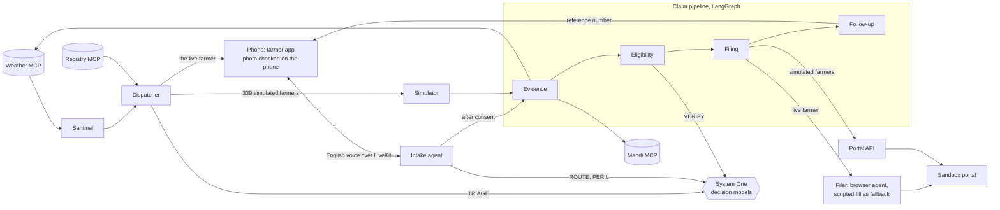

# 72 Ghante

After a hailstorm, an insured farmer in India has 72 hours to report the crop loss, or the claim may not be assessed. Today the system waits for the farmer to come forward. 72 Ghante goes to the farmer: when a storm hits, agents phone every affected insured farmer in English, collect what happened and a photo, check eligibility, and file the crop-loss intimation before the window closes.

A hackathon build for the Agriculture and Climate track. It runs on one Windows laptop and an Android phone, on open-source software and free tiers. Nothing has been paid for.

## What the demo shows

- **One live farmer.** A real English call on an Android phone, in the browser over LiveKit. The agent says it is an automated assistant, then asks about the damage, the plot, the cause, the time, the share of the crop lost and the crop stage, asks for a photo, reads everything back and asks for consent.
- **The photo is checked on the phone** by a small vision model running in the phone's browser, with no server involved.
- **Small, fast models make the routine decisions** ("System One"): whether a reply can be handled without the large language model, what caused the damage, who to call first, and whether the statement, the photo and the weather record agree.
- **A browser agent fills in the insurer's form** on a sandbox portal, page by page, the way a person would. The agent reads the reference number to the farmer before hanging up, and a message card with the number arrives on the phone.
- **339 simulated farmers** in the same storm are ranked, called, checked and filed at the same time, on a district map with a 72-hour countdown.

**What is simulated.** The 339 other farmers are scripted personas, and the dashboard says so ("Simulated farmers: 339. Live: 1."). Their cases still go through the same MCP tool servers, the same eligibility rules and the same decision models (a question already answered in the same run, word for word, is answered from memory and marked "cached" in the ticker). They skip the voice call and the browser: their reports go to the portal's API. The insurer portal is our own "FasalClaim Sandbox", labelled as a sandbox on every page, with fictional people. Nothing is filed anywhere real. The storm is a recorded scenario, replayed. Every number on the dashboard is measured during that run.

## How it works



Every agent reports to an event bus in the orchestrator, and the dashboard on the projector draws those events: the map, the counters, the decision ticker, the MCP calls and every fallback that fires.

| Part | What it is | Code |
|---|---|---|
| Voice | LiveKit Agents 1.8.5 with Deepgram speech-to-text. Sarvam's Indian-English voice, played from a pre-built audio cache, with the local Piper voice as the fallback. Every question is a fixed English line; the LLM (Groq, free tier) only extracts the answers as JSON | `apps/voice/` |
| System One | A small classifier trained on a multilingual sentence encoder, for the farmer's replies (ROUTE, PERIL); the open Laya model for English reports (TRIAGE, VERIFY); an LLM only as the fallback | `apps/s1/` |
| Edge model | MobileCLIP-S0 in the phone's browser (transformers.js), with an offline queue | `apps/web/farmer.*`, `apps/web/edge-worker.js` |
| Orchestration | Sentinel, Dispatcher and Simulator as asynchronous agents; the claim pipeline as a LangGraph graph | `apps/orchestrator/` |
| MCP | Three tool servers (weather, farmer registry, mandi prices) on the official MCP Python SDK, used by the voice agent, the pipeline, the Sentinel and the Dispatcher | `mcp_servers/` |
| Browser agent | browser-use 0.13 with Groq `openai/gpt-oss-120b`, one small agent per form page; a Playwright fill by field id takes over if the agent fails | `apps/filer/` |

The design is in `context/` (start with `context/README.md`). Ports, events and fields are in `context/SystemDesign.md`.

## Measured on the team laptop

| What | Measured | Recorded in |
|---|---|---|
| English ROUTE decision on a reply | 29/30 correct; median 32 ms, p95 37 ms | `docs/FINAL-FOLDER-SYNC.md` |
| Agent's thinking time when the LLM is needed (no audio) | median 0.66 to 0.96 s over three runs | `context/Phase2Results.md`, `context/Phase3Results.md` |
| Photo check with the phone's model, in the laptop's browser | 240 ms per photo (the phone will be slower; not yet measured) | `context/Phase2Results.md` |
| Browser agent filling the three-page form | 5 of 5 correct, median 32 s, 3 LLM calls each | `context/Phase3Results.md` |
| Scripted fill (the fallback) | 0.7 s | `context/Phase3Results.md` |
| District run of 340 farmers | 312 filed, 11 unreachable, 9 with no damage, 5 sent to a person, 3 not eligible; 73 and 74 s; "68 hours left" | `context/Phase4Results.md` |

`scripts/report.py` prints these numbers from the last run.

## Run it

**Each time** (the laptop is already set up):

1. Double-click `setup\7-start-everything.cmd`. It starts the services, the decision models, the Filer's browser window and the voice worker, and opens the dashboard. Wait about a minute: the decision models load and answer one practice question each.
2. For one reusable judge-demo link, follow `setup/SINGLE-FARMER-LINK.md` once, then double-click `setup\9-stable-farmer-link.cmd`. It prints and saves the complete `/farmer` URL in `var/farmer-link.txt`; bookmark it on the phone. The free ngrok account's assigned domain stays the same across restarts, but the laptop and tunnel must be running. For a temporary link without an account, `setup\8-phone-link.cmd` still works. Open the farmer page in Chrome, press the big button once, and allow the microphone and camera.
3. Check readiness: open a Command Prompt in the project folder and run `.venv\Scripts\python.exe scripts\smoke.py`. Every line under "On-stage readiness" should say OK: scenario reset, phone connected, decision models loaded and warmed, Filer window open, browser agent usable.
4. On the dashboard: **S** starts the storm, **H** rings the live farmer (the district pauses), **P** resumes the district after the call, **R** twice resets (the first press asks for the second). `context/DemoScript.md` has the talk, beat by beat.

To skip the browser agent (no LLM, no limits), start with `setup\7-start-everything.cmd scripted`.

**First time on a new laptop:**

1. Part A of `setup/SETUP-TONIGHT.md`: install the tools (Git, uv, Node.js, cloudflared, the LiveKit CLI, then Python 3.12 through uv) and check them. The Filer drives Google Chrome, or Microsoft Edge when Chrome is not installed.
2. Double-click `setup\2c-install-packages.cmd`. It creates the three Python environments with the exact package versions tested on the team laptop (`.venv` for the services and models, `.venv-voice` for the voice agent, `.venv-browser` for the Filer) and downloads the local English voice. About 3 GB.
3. Part B of `setup/SETUP-TONIGHT.md`: create the free accounts (LiveKit Cloud, Deepgram, Sarvam AI, Groq, Google AI Studio; none needs a card), copy `.env.example` to `.env` and paste the keys (`setup\4-open-env.cmd`), then run `setup\3-check-keys.cmd`.
4. The spoken lines: copy the `var\tts_cache` folder from the team laptop (free), or build it with `.venv-voice\Scripts\python.exe scripts\build_tts_cache.py` (uses some of the free Sarvam credit; `--dry-run` shows how much first).
5. The decision models and the phone's photo model download themselves the first time they are used.

## Checks that need no person

Open a Command Prompt in the project folder.

| Command | What it checks |
|---|---|
| `.venv\Scripts\python.exe -m unittest tests.test_phase1 tests.test_phase2 tests.test_phase3 tests.test_phase4 tests.test_phase5` | The automated tests for every gate |
| `set GHANTE_SERVICE_PYTHON=%CD%\.venv\Scripts\python.exe` then `.venv-browser\Scripts\python.exe -m unittest tests.test_phase5.T5_Dashboard tests.test_phase4.T4_Fleet.test_T4_08_dashboard_shows_the_run` | The dashboard tests in the installed Chrome (they need Playwright, which only `.venv-browser` has): a dashboard opened mid-demo, the projector sizes, a district run on screen |
| `.venv-voice\Scripts\python.exe scripts\demo_check.py` | The whole demo five times in a row, from reset: storm, the live call as text, the browser filing, the district to the closing banner |
| `.venv-voice\Scripts\python.exe scripts\voice_text_check.py` | The voice agent as text, with the real LLM and models |
| `.venv\Scripts\python.exe scripts\filing_check.py --visible` | The browser agent and the scripted fill, in a window you can watch |
| `.venv\Scripts\python.exe scripts\fleet_check.py` | The district run alone, with timings |
| `.venv\Scripts\python.exe scripts\drills.py` | Fallback drills: a broken decision model, a slow browser agent, a wrong LLM key, the Filer or the orchestrator stopped mid-run |
| `.venv\Scripts\python.exe scripts\report.py` | The numbers from the last run |
| `.venv\Scripts\python.exe scripts\usage.py` | How much of each free allowance has been used |
| `.venv\Scripts\python.exe scripts\secrets_check.py` | That no key appears anywhere outside `.env` |

The tests and checks use their own ports (18000 and up) and a temporary folder, so they do not disturb a running demo.

## Rules this build keeps

- Sandbox portal only, with its banner. The Filer refuses any other address, and the browser agent is limited to the sandbox's domain.
- Synthetic people only: generated names, `+91 00000` phone numbers, `APP-SEH-` application numbers.
- Simulated and live are labelled everywhere; every fallback that fires is shown on the dashboard.
- The agent says it is an automated assistant, asks for consent before filing, never promises money, and offers a person.
- Keys live only in `.env`, which git ignores; `scripts/secrets_check.py` looks for leaks.
- Zero spend: free tiers and signup credits without a card.

## Folders

```
apps/orchestrator   API, event bus, cases, the district run, the claim pipeline (port 8000; also serves the web pages)
apps/voice          the Intake voice agent (LiveKit) and its call logic
apps/s1             System One decision service (port 8200)
apps/filer          browser agent and scripted fill (port 8300)
apps/portal         FasalClaim Sandbox, the stand-in insurer portal (port 8090)
apps/web            dashboard and farmer app (plain HTML, CSS and JavaScript)
mcp_servers         weather, registry and mandi MCP servers (ports 8101 to 8103)
ghante_shared       settings, database, data models, MCP client
data                scenario, synthetic farmers, training and evaluation sets
scripts             start-up, checks, drills, report
tests               automated tests, one file per gate
context             plan, design, test plans and measured results
setup, run          double-click helpers for the Windows laptop
```

For checkout repairs and earlier validation, see [checkout validation](docs/KRISHIKAVACH-RUNNABILITY.md).

For the final-folder comparison and current English validation, see [final-folder update](docs/FINAL-FOLDER-SYNC.md). The [project explanation PDF](docs/72-Ghante-Project-Explained.pdf) is also included.

## Automatic weather watch

The backend now checks live Open-Meteo weather for the 12 seeded Sehore villages every five minutes. Current weather and the next six forecast hours are screened for configurable crop-risk signals. A verified signal starts the synthetic sandbox storm automatically; no Start storm click is required. Existing runs and cooldown are preserved. The dashboard shows live/demo source, checked time and measured reasons.

For a reliable presentation, start the app, then run `setup/10-weather-demo.cmd`. It resets the sandbox and arms clearly labelled simulated weather: clear initially, hail and strong gusts after 20 seconds. The same monitor starts the storm and opens 340 cases. Press Call hero to continue the existing phone demonstration. Choose Live weather afterward to restore the real API. See [weather feature and judge script](docs/AUTOMATIC-WEATHER.md).


## Multilingual speech

Sehore now starts in Hindi, and the live call supports Hindi, English, Malayalam and Tamil. See [MULTILINGUAL.md](MULTILINGUAL.md) for setup, testing and the presentation script. The dashboard labels translated farmer transcripts.
