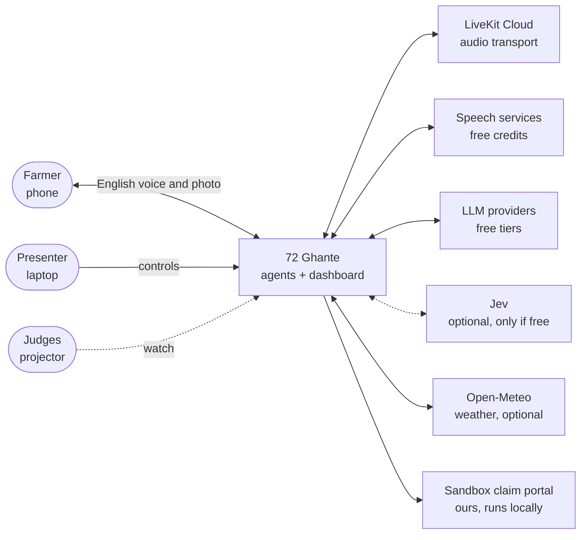
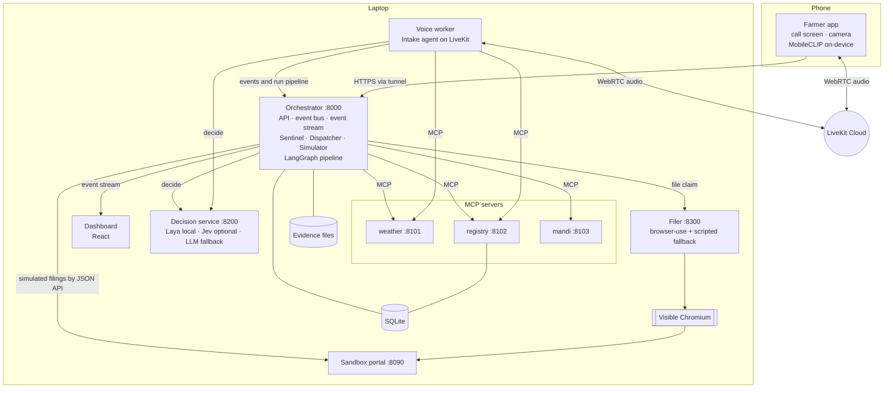
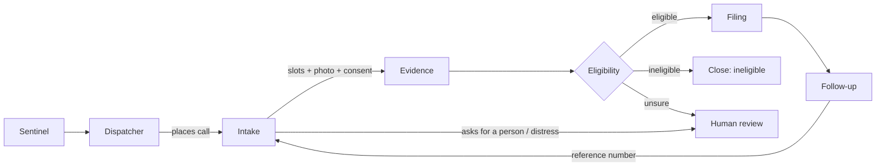
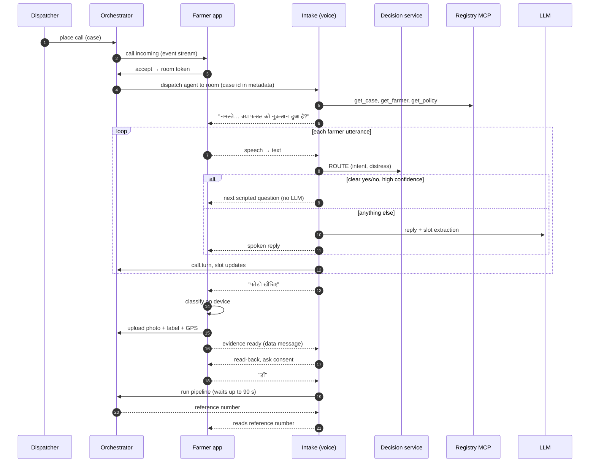
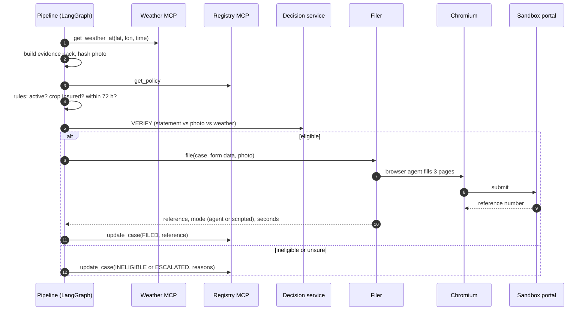
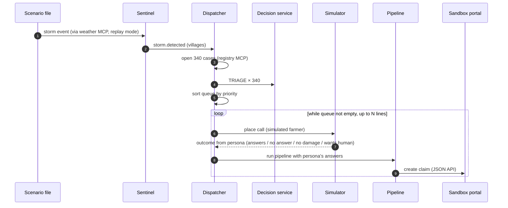
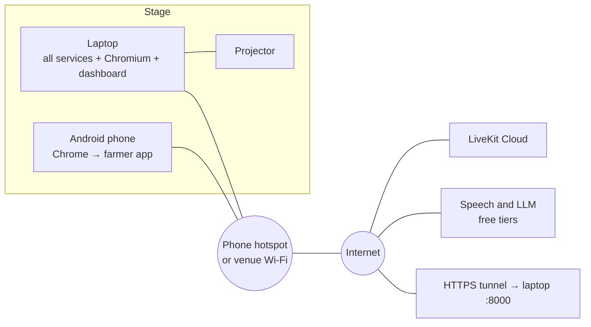

# Architecture design

This file explains the shape of the system and why. Exact schemas, endpoints and prompts are in `SystemDesign.md`.

## 1. Design principles

1. **Contract first.** Components talk only through the schemas, endpoints and events in `SystemDesign.md`. Two people (or two Claude sessions) can build two components at once.
2. **Event-driven and observable.** Every meaningful step emits an event. The dashboard is only a view of the event stream, so what judges see is what happened.
3. **A fallback for every external dependency,** switched by an environment variable and rehearsed.
4. **One path for everyone.** Simulated farmers go through the same triage, eligibility and filing code as the hero. Only the human-facing ends (voice, camera, browser window) are swapped out.
5. **Fast decisions and slow thinking are separate.** Bounded decisions go to the System One service. Open conversation goes to the LLM. Rules and arithmetic are plain code.
6. **Small processes.** Each risky dependency (voice, browser, decision model) lives in its own process so one crash does not end the demo.

## 2. Context

Everything inside "72 Ghante" and the sandbox portal runs on the team laptop. The phone reaches the laptop through an HTTPS tunnel and reaches LiveKit Cloud directly.

## 3. Components

| Component | Responsibility | Does not do |
|---|---|---|
| **Farmer app** (phone, same Vite app as dashboard, route `/farmer`) | Incoming-call screen, audio, camera, on-device classification, offline queue, message cards | Any business logic |
| **Dashboard** (route `/`) | Renders the event stream: map, counters, ticker, agent strip, hero panel; presenter controls | Hold state of its own beyond what events tell it |
| **Orchestrator** | Owns cases and their state machine; runs Sentinel, Dispatcher, Simulator and the LangGraph pipeline; event bus; REST and event streams | Speech, browser automation, model inference |
| **Voice worker** | The Intake agent: English conversation, slot filling, fast path, escalation | Decide eligibility, file anything itself |
| **Decision service** | One endpoint for all System One decisions; provider fall-through; latency logging | Know anything about cases |
| **Filer** | Drive the browser through the portal form; scripted fallback; step events | Decide what to file |
| **MCP servers** | Weather, registry (farmers, policies, cases), mandi prices | Orchestrate |
| **Sandbox portal** | A realistic multi-page claim form with an admin list and a JSON API | Pretend to be a government site |

## 4. The seven agents

| # | Agent | Lives in | Trigger | Tools | Uses LLM? | Uses System One? |
|---|---|---|---|---|---|---|
| 1 | **Sentinel** | Orchestrator | Scenario start / polling | weather MCP | No | No |
| 2 | **Dispatcher** | Orchestrator | `storm.detected` | registry MCP, decision service | No | **TRIAGE** |
| 3 | **Intake** | Voice worker | Dispatched to a call | registry MCP, weather MCP, decision service | Yes | **ROUTE**, **PERIL** |
| 4 | **Evidence** | Pipeline node | Call collected slots + photo | weather MCP, mandi MCP (P1) | Optional, for the summary sentence | No |
| 5 | **Eligibility** | Pipeline node | Evidence pack ready | registry MCP, decision service | No | **VERIFY** |
| 6 | **Filing** | Pipeline node → Filer | Verdict = eligible | Browser | Yes (browser agent) | No |
| 7 | **Follow-up** | Pipeline node | Filing done | registry MCP | No (templates) | No |

## 5. Main flows

### 5.1 Hero call

### 5.2 Claim pipeline

### 5.3 Fleet

The hero case is taken out of the queue and placed by the presenter at the chosen moment. While the hero call is live the simulation clock is paused.

## 6. Real and simulated

| Thing | Hero farmer | Simulated farmers |
|---|---|---|
| Storm event | Replayed scenario | Same |
| Case creation, 72-hour deadline | Real | Real |
| System One TRIAGE | Real | Real |
| The call | Real voice | Scripted outcome |
| System One ROUTE / PERIL | Real, on speech | Not run (no speech) |
| Photo and on-device model | Real | Pre-labelled sample photo reference |
| Weather check, eligibility rules, VERIFY | Real | Real |
| Filing | Browser agent in a visible window | JSON API of the same portal |
| Reference number | Real, from the portal | Real, from the portal |
| Clock | Real time, stopwatch | Compressed scenario time |

## 7. Honesty and safety rules

1. **Sandbox portal only.** Own name ("FasalClaim Sandbox"), own look, a permanent banner "Demo sandbox — not a government website". No government names, logos, emblems or colours.
2. **Synthetic people only.** Names, phone numbers, application numbers and plots are generated. Phone numbers use an obviously fake pattern.
3. **Label the simulation.** The dashboard shows "LIVE" on the hero and "Simulated: N" on the fleet at all times.
4. **Label fallbacks.** If the scripted fill or the LLM decision fallback runs, the dashboard says so.
5. **Report measured numbers.** Latencies on screen are measured in that run, not typed in.
6. **The agent is honest with the farmer.** It says it is an automated assistant, says who it calls on behalf of, asks consent before filing, never promises money, and offers a person.
7. **Secrets** live in `.env` and are never committed or logged.

## 8. Deployment for the demo

- The orchestrator serves the web app and the API on one port, so one tunnel URL serves the farmer app and its API.
- The phone opens the tunnel URL at `/farmer`. The laptop opens `http://localhost:8000/`.
- Internet is required for speech and the LLM. System One (Laya), the edge model and the fallback voice (Piper) run locally. If the venue network fails, the laptop and the phone both join a second phone's hotspot.

## 9. Trade-offs we accepted

| Decision | Gain | Cost |
|---|---|---|
| Browser call in a web app, not a real phone number | Free, no telephony setup, no regulatory steps, works on any network | Less "it's a real phone call" effect; real telephony needs a paid provider and is out of scope |
| Zero budget: open models and free tiers only | Costs nothing; shows the system does not depend on expensive services | Rationed live speech, free-tier rate limits, and possibly an open System One model instead of Jev; each has a local fallback |
| Sandbox portal, not a real one | Legal, reliable, ours to shape | Judges may ask; the answer is in `ProblemStudy.md` §7 |
| Zero-shot edge model | No training, ready on Day 1 | Accuracy unknown until tested; probe fallback planned |
| Cascaded voice pipeline | A hook for System One, visible timings | A little slower than speech-to-speech models |
| Fleet is simulated | A district-scale story in 90 seconds | Must be labelled; only one call proves the voice path |
| Many small processes | Isolation, parallel work | More to start; solved by `scripts/dev.py` |
| SQLite, in-process event bus | Zero setup | Not horizontally scalable; irrelevant for a demo, and said plainly if asked |

## 10. Path to a real deployment

For the "feasibility" question, not for the build.

1. The caller is the insurer or the state agriculture department, using its own enrolment data, so consent and identity already exist.
2. Calls go over the normal phone network through a telephony provider; the voice agent is unchanged.
3. Filing uses the insurer's own intake API where one exists and a browser agent with delegated access where only a web form exists.
4. Weather triggers come from IMD and insurer weather stations; satellite imagery is added to the evidence pack.
5. Humans stay in the loop for every escalation and for every assessment.
