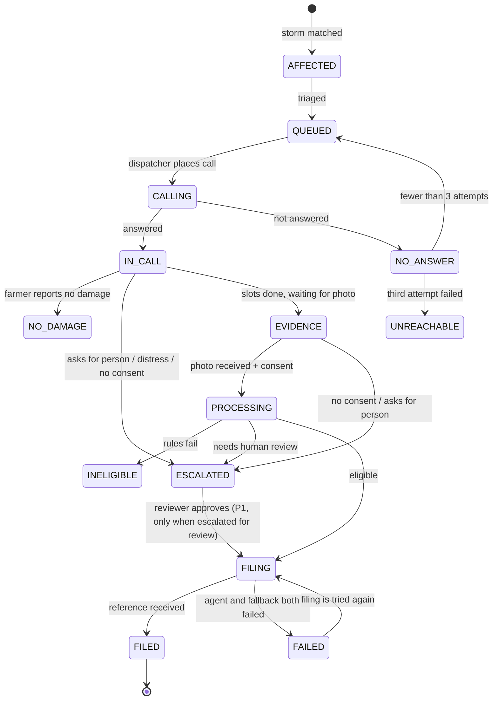

# System design

Concrete contracts for the build. Names, ports, fields and event types here are canonical: use them exactly. Library calls must be checked against current documentation before use (`TechDecisions.md`).

## 1. Repository layout

As built up to Phase 4 (7 Oct 2026). Folders marked "later" do not exist yet.

```
GopalK/
├─ CLAUDE.md
├─ context/                  planning documents (this folder)
├─ .env.example              every variable from §3, no secrets
├─ requirements.txt          Python packages for the backend
├─ pyproject.toml
├─ ghante_shared/            shared Python package (at the project root so `python -m ...` finds it without installing)
│  ├─ config.py              reads .env; paths, ports, URLs
│  ├─ models.py              statuses, transitions, slots, perils, event envelope
│  ├─ db.py                  SQLite schema and seed loading (standard-library sqlite3)
│  ├─ http.py                JSON-over-HTTP helpers, post_event()
│  ├─ mcp_client.py          call_tool() that also emits mcp.tool_called
│  ├─ usage.py               logs/usage.json
│  └─ geo.py
├─ apps/
│  ├─ orchestrator/          Starlette :8000 — API, event bus, event stream, claim pipeline, and the district run
│  │  ├─ main.py
│  │  ├─ bus.py              in-process pub/sub + JSONL log
│  │  ├─ cases.py            case store + state machine (single writer)
│  │  ├─ clock.py            scenario clock
│  │  ├─ pipeline/           rules.py (eligibility checks and the form, no I/O), graph.py (LangGraph or the built-in runner), service.py (the four agents)
│  │  ├─ scenario.py         start, pause, resume, reset of the district run; clock messages
│  │  ├─ sentinel.py         storm detection through the weather MCP server
│  │  ├─ dispatcher.py       opens cases, TRIAGE, priority queue, parallel calls, retries, calling hours
│  │  └─ simulator.py        plays the non-hero farmers from their personas
│  ├─ s1/                    Decision service :8200
│  │  ├─ main.py
│  │  ├─ decisions.py        questions, chains and report rendering for TRIAGE, ROUTE, PERIL, VERIFY
│  │  └─ providers/          head.py, laya.py, llm.py, mock.py (tests only)
│  ├─ portal/                Sandbox claim portal :8090 (Starlette + Jinja templates)
│  ├─ web/                   dashboard (index.html, styles.css, app.js) and farmer app (farmer.html) as plain HTML, CSS and JavaScript, served by the orchestrator at `/`, `/farmer` and `/static/`
│  ├─ voice/                 LiveKit worker — Intake agent: agent.py (skeleton in Phase 1), lines.py (scripted English lines), prompts.py. Runs from `.venv-voice`
│  └─ filer/                 :8300 — main.py (service), browser.py (the one visible window), agent_mode.py (browser-use), scripted.py (Playwright). Runs from `.venv-browser`
├─ mcp_servers/              weather.py :8101, registry.py :8102, mandi.py :8103 (named mcp_servers so it does not hide the installed `mcp` SDK)
├─ data/
│  ├─ scenarios/sehore_hail.json
│  ├─ seed/                  villages.json, farmers.json (generated by scripts/seed.py; committed)
│  ├─ eval/                  route_train.jsonl, peril_train.jsonl (head training data), s1_eval.jsonl; edge/ sample photos
│  └─ fixtures/              mandi.json, events_sample.jsonl
├─ scripts/                  dev.py, seed.py, reset.py, smoke.py, eval_s1.py, usage.py, replay_events.py, live_check.py, voice_text_check.py, check_keys.py, check_livekit.py, spikes/
├─ tests/                    unittest tests named by test ID from Testing.md (test_phase1.py, _util.py)
├─ run/, setup/              helper scripts used during setup and Phase 0
├─ logs/                     events.jsonl, usage.json, per-process logs (git-ignored)
└─ var/                      app.db, portal.db, evidence/, portal_uploads/, tts_cache/ (git-ignored)
```

**Choices made while building Phase 1** (also in the `TechDecisions.md` change log):
- **Starlette, not FastAPI.** FastAPI is Starlette plus validation we do by hand in a few lines; one dependency fewer.
- **Standard-library `sqlite3`, not SQLModel.** The data model of §4 is unchanged.
- **Server-Sent Events, not WebSockets,** for the two one-way streams (dashboard and farmer phone). The browser's `EventSource` reconnects by itself, it needs no extra server library, and it passes through tunnels as ordinary HTTP.
- **MCP Python SDK 2.x.** `FastMCP` was renamed `MCPServer` (`from mcp.server.mcpserver import MCPServer`); the client is `mcp.Client(url)`. `mcp_servers/_base.py` and `ghante_shared/mcp_client.py` hide the difference and still accept 1.x.
- **`unittest`, not pytest.** No extra dependency; pytest can still run the same files.
- **No-build web app.** The dashboard and farmer app are plain HTML, CSS and JavaScript modules served by the orchestrator, not a Vite/React project: nothing to install with npm (package downloads were unreliable on the team's network), one port for the phone tunnel, and it can be tested in a headless browser.

## 2. Processes and ports

| Process | Port | Start command (run by `python scripts/dev.py`) |
|---|---|---|
| Orchestrator (also serves the web app) | 8000 | `python -m apps.orchestrator.main` |
| Sandbox portal | 8090 | `python -m apps.portal.main` |
| MCP weather | 8101 | `python -m mcp_servers.weather` |
| MCP registry | 8102 | `python -m mcp_servers.registry` |
| MCP mandi | 8103 | `python -m mcp_servers.mandi` |
| Decision service | 8200 | `python -m apps.s1.main` |
| Filer | 8300 | `.venv-browser\Scripts\python.exe -m apps.filer.main` (`dev.py` picks that environment by itself). Opens the browser window when it starts |
| Voice worker | — | `.venv-voice\Scripts\python.exe -m apps.voice.agent dev` (started by `dev.py --voice`); `... agent console` to talk to it with the laptop's microphone |
| Tunnel | — | `setup/9-stable-farmer-link.cmd` for an ngrok free assigned domain and reusable `/farmer` link; `setup/8-phone-link.cmd` remains the temporary cloudflared/SSH fallback |

Every service answers `GET /health`. Each MCP server exposes streamable HTTP at `/mcp`. `scripts/dev.py` starts everything that is built, prefixes log lines with the process name, writes `logs/<name>.log`, and stops everything on Ctrl+C. Options: `--only a,b`, `--no-s1`, `--voice`, `--list`. The voice worker is started only with `--voice`, because it needs its own environment and connects to LiveKit Cloud.

Run everything from the project root with the project's Python: `.venv\Scripts\python.exe scripts\dev.py`.

**Two Python environments.** `.venv` holds the backend (Starlette, MCP, torch, Laya). `.venv-voice` holds LiveKit Agents 1.8.5 and its plugins. They are separate so that LiveKit's dependencies and the model libraries cannot disturb each other. The voice code imports only `ghante_shared` (standard library plus the MCP SDK) from the rest of the project. `.venv-browser` holds the Filer: browser-use, Playwright, Starlette and uvicorn. LangGraph is installed in `.venv` (the pipeline runs inside the orchestrator).

## 3. Environment variables

| Variable | Example | Purpose |
|---|---|---|
| `NGROK_AUTHTOKEN` | (secret, `.env` only) | Optional free ngrok account token for the reusable farmer link. The ngrok CLI may be on PATH or in `.setup-tools/bin/ngrok.exe`. |
| `LIVEKIT_URL`, `LIVEKIT_API_KEY`, `LIVEKIT_API_SECRET` | | LiveKit Cloud project |
| `DEEPGRAM_API_KEY`, `SARVAM_API_KEY`, `GROQ_API_KEY`, `GEMINI_API_KEY` | | Keys for the free services; leave blank any we do not have |
| `STT_PROVIDER` | `deepgram` \| `sarvam` | Speech-to-text (Groq Whisper is not wired) |
| `TTS_PROVIDER` | — | Not read any more. The order is fixed in `agent.py`: audio cache, then Sarvam (only when `CREDIT_SAVER=0`), then local Piper (§10.3a) |
| `PIPER_VOICE` | `en_US-lessac-medium` | Local voice (the file is expected in `var/piper/`) |
| `CREDIT_SAVER` | `1` \| `0` | `1` (development default): TTS from cache and Piper only, scripted filing, local System One |
| `TTS_VOICE` | `simran` | Voice name |
| `LLM_CHAIN` | `groq:openai/gpt-oss-20b,gemini:gemini-3.1-flash-lite` | Conversation LLM providers in order; next one on a rate-limit error (set in Phase 0) |
| `BROWSER_LLM_CHAIN` | `groq:openai/gpt-oss-120b,gemini:gemini-3.8-flash` | Free-tier LLMs for the browser agent: the first with a key fills the form, the second is the fallback when a request fails. A blank value means this default |
| `S1_CHAIN_TEXT` | `head,llm` | Providers, in order, for decisions on the farmer's replies: ROUTE and PERIL |
| `S1_CHAIN_REPORT` | `laya,llm` | Providers, in order, for decisions on English reports: TRIAGE and VERIFY |
| `HEAD_ENCODER` | `intfloat/multilingual-e5-small` | Sentence encoder for the trained head |
| `S1_TIMEOUT_MS_HEAD`, `S1_TIMEOUT_MS_LAYA`, `S1_TIMEOUT_MS_LLM` | `500`, `2000`, `8000` (the defaults) | Move to the next provider after this many milliseconds. One limit per provider, because a 20 ms head and a 2 s hosted LLM cannot share one. The first call of a local model is allowed to load it. The old single `S1_TIMEOUT_MS` is no longer read |
| `FAST_PATH_MIN` | `0.5` | Lowest ROUTE confidence at which the call takes the fast path (§10.3). On the evaluation set no fast-path turn was wrong at 0.40 or above |
| `JEV_BASE_URL`, `JEV_API_KEY`, `JEV_MODEL` | | Only if a Jev key was obtained free, with no payment method |
| `LAYA_MODEL` | `convaiinnovations/laya-multilingual` | Local model id |
| `S1_SIM_CACHE` | `1` \| `0` | `1` (default): for simulated farmers, a decision whose input reads exactly the same as an earlier one in this run is not computed again; the repeat is marked "cached" in the ticker. The live farmer's decisions are always computed. The memory is emptied on reset |
| `FILING_MODE` | `auto` \| `agent` \| `scripted` | `auto` = agent, then scripted on failure. Unset: `scripted` while `CREDIT_SAVER=1`, otherwise `auto` |
| `FILING_TIMEOUT_S` | `75` | Browser agent wall-clock limit |
| `FILING_MAX_STEPS` | `20` | Browser agent step limit |
| `PIPELINE_WAIT_S` | `90` | How long `POST /api/cases/{id}/pipeline/run` waits before answering `pending` |
| `FILER_WINDOW` | `900x1000+1000+0` | Size and position of the Filer's browser window: width x height + left + top. Blank: the right-hand 42 % of the screen |
| `FILER_FIELD_DELAY_MS` | `250` | Pause after each field in the scripted fill, so the audience can follow |
| `FILER_BROWSER_PATH` | | A specific Chrome, Edge or Chromium to use; otherwise Chrome, then Edge, is found by itself |
| `FILER_OPEN_AT_START` | `1` | Open the browser window when the Filer starts (`0`: on the first report) |
| `FILER_TEST_DELAY_S` | `0` | Test T3-09 only: the Filer waits this long before filing |
| `FILER_HEADLESS`, `FILER_CDP_PORT`, `FILER_PROFILE_DIR` | `0`, `9333`, `var/filer_profile` | No window (tests); the window's debugging port; its own browser profile |
| `WEATHER_MODE` | `replay` \| `live` | Scenario file or Open-Meteo |
| `MANDI_MODE` | `fixture` \| `live` | Fixture or data.gov.in |
| `DATA_GOV_API_KEY` | | Only for `MANDI_MODE=live` |
| `EDGE_MODE` | `zeroshot` \| `probe` \| `binary` | Read by the web app at build time as `VITE_EDGE_MODE` |
| `SIM_SPEED` | `180` | Scenario seconds per real second |
| `MAX_PARALLEL_CALLS` | `8` | Dispatcher concurrency (tuned in Phase 4: with 6 the retries ran past the 20:00 end of calling hours) |
| `SCENARIO` | `sehore_hail` | Scenario id |
| `HERO_FLOW` | `full` \| `short` | `short` asks fewer questions (§10.2) for a three-minute demo |
| `PHOTO_TIMEOUT_S` | `60` | How long the agent waits for the photo before going on without it |
| `RING_TIMEOUT_S` | `30` | How long the phone rings before the call counts as not answered |
| `VOICE_LLM_TIMEOUT_S` | `6` | Time limit for one LLM request on the call before the next provider is tried |
| `VOICE_LLM_HEDGE_S` | `2` | Send the same LLM request a second time when the first has not answered after this many seconds; `0` turns it off |
| `LLM_BACKUPS` | `groq:openai/gpt-oss-120b,gemini:gemini-3.1-flash-lite,gemini:gemini-flash-lite-latest` | Models tried after `LLM_CHAIN` (rate limit or outage). `gemini-3.8-flash` has no free quota on the team key (Phase 5) |
| `S1_PRELOAD` | `1` | Load the local decision models when the service starts and have each answer one made-up ROUTE, PERIL and TRIAGE question (never shown), so the first decision of a live call is not the slow one; `GET /health` on the decision service lists them under `warmed` (Phase 5) |
| `HERO_FARMER_ID` | `F0001` | The farmer used when the voice agent is started with no case (console mode) |
| `HERO_SIM` | `0` \| `1` | `1` gives the hero a scripted persona so the whole scenario can run headless in tests |
| `ORCH_URL`, `S1_URL`, `FILER_URL`, `PORTAL_URL` | `http://localhost:8000` … | Service addresses |
| `MCP_WEATHER_URL`, `MCP_REGISTRY_URL`, `MCP_MANDI_URL` | `http://localhost:8101/mcp` … | MCP addresses |

## 4. Data model

SQLite at `var/app.db`, WAL mode. The orchestrator is the only writer of `cases`, `evidence` and `call`. The schema is in `ghante_shared/db.py`. The case table is named `cases` because `case` is a reserved word in SQL.

**village**: `id`, `name`, `tehsil`, `district`, `state`, `lat`, `lon`

**farmer**: `id`, `name`, `mobile` (fake pattern `+91 00000 0NNNN`), `village_id`, `is_hero` (bool), `notes` (short free text used by TRIAGE), `sim` (JSON, null for the hero — see §12)

**policy**: `id`, `farmer_id`, `application_no` (`APP-SEH-NNNNNN`), `season` (`Rabi 2025-26`), `crop` (`wheat`), `khasra_no`, `insured_area_ha`, `sum_insured_inr`, `status` (`active` \| `lapsed`), `valid_from`, `valid_to`, `plot_lat`, `plot_lon`

**storm_event**: `id`, `type` (`hailstorm`), `started_at`, `center_lat`, `center_lon`, `radius_km`, `villages` (JSON list of `{village_id, intensity: light|moderate|severe, distance_km}`)

**case**: `id`, `farmer_id`, `policy_id`, `storm_event_id`, `status` (§5), `priority` (float), `deadline_at`, `attempts`, `slots` (JSON, below), `verdict` (`eligible` \| `ineligible` \| `review` \| null), `verdict_reasons` (JSON list), `claim_ref`, `filing_mode` (`agent` \| `scripted` \| `api`), `opened_at`, `filed_at`, `time_to_file_s`, `is_hero`

**evidence**: `id`, `case_id`, `photo_path`, `sha256`, `edge_label`, `edge_confidence`, `edge_latency_ms`, `edge_mode`, `lat`, `lon`, `captured_at`, `uploaded_at`, `captured_offline` (bool), `weather` (JSON from weather MCP), `distance_from_plot_m`, `loss_estimate_inr` (P1)

**call**: `id`, `case_id`, `attempt`, `room`, `started_at`, `ended_at`, `outcome` (`completed` \| `no_answer` \| `declined` \| `escalated` \| `wrong_person` \| `dropped`)

**Slots** (the `case.slots` JSON):

```json
{
  "identity_confirmed": null,
  "damage_confirmed": null,
  "khasra_confirmed": null,
  "cause_text": null,
  "peril": null,
  "loss_time_text": null,
  "loss_datetime": null,
  "damage_pct": null,
  "crop_stage": null,
  "consent": null
}
```

`peril` ∈ `hailstorm | inundation | landslide | cloudburst | natural_fire | unseasonal_rain | cyclone | not_covered`. `crop_stage` ∈ `standing | harvested`.

The sandbox portal has its own database `var/portal.db` with one table `claim` holding the form fields of §14, `reference`, `created_at`, `submitted_via` (`form` \| `api`).

## 5. Case state machine



Only `cases.py` changes status. Every change emits `case.status_changed`. Invalid transitions raise an error.

A call that drops while the case is `IN_CALL` or `EVIDENCE` leaves the status as it is; ringing again (`POST /api/hero/call`) starts a new call for the same case and the agent resumes at the first missing slot.

Terminal statuses: `FILED`, `NO_DAMAGE`, `ESCALATED`, `INELIGIBLE`, `UNREACHABLE`, `FAILED`.

## 6. Orchestrator API

All under `/api`, JSON, no auth (local demo).

**Built in Phase 5:** the dashboard stream replays recent events to a dashboard that connects mid-demo (see `GET /api/events/stream`); `GET /health` also returns `pipeline_engine`, `scenario` and `hero_phones`.

**Built in Phase 4:** `POST /api/scenario/start`, `/pause` and `/resume`, `GET /api/queue`. `GET /api/state` (and every `snapshot`) also carries `farms` (every insured plot, so the map shows them before the storm) and `scenario` (`{state: idle|running|paused|finished, paused_by, fleet_finished, total, triaged, triage_done, waiting, retry_later, on_call, max_parallel, max_on_call_seen, running_seconds, speed}`).

**Built in Phase 3:** `POST /api/cases/{id}/pipeline/run`, `POST /api/cases/{id}/review`, `GET /api/cases/{id}/evidence-pack`. Case summaries in `GET /api/state` carry `verdict`.

**Built in Phase 2:** `POST /api/hero/call`, `POST /api/calls/{call_id}/accept`, `/decline` and `/end`, `POST /api/cases/{id}/evidence`, `GET /api/evidence/{evidence_id}/photo`, `GET /api/farmers/{farmer_id}`, `GET /sw.js`.

**Built in Phase 1:** the pages `GET /` (dashboard), `GET /farmer` (farmer app) and `GET /static/…` (their files), `GET /api/state`, `POST /api/scenario/reset`, `POST /api/cases`, `GET /api/cases/{id}`, `PATCH /api/cases/{id}/slots`, `POST /api/cases/{id}/status`, `POST /internal/events`, the two streams and `GET /health`. The other rows are built in the phase that needs them.

| Method and path | Body | Returns | Used by |
|---|---|---|---|
| `GET /api/state` | — | `{clock, stats, storm, cases:[…summary]}` | Dashboard on load |
| `POST /api/scenario/start` | optional `{speed}` | `{ok, …scenario}`; 409 if already started (reset first). The clock jumps to the detection time and runs | Presenter |
| `POST /api/scenario/pause` / `resume` | `resume`: optional `{speed}` | `{ok, changed, …scenario}`. Pause freezes the clock and every simulated farmer; resume also ends the pause that the hero call set | Presenter |
| `GET /api/queue` | — | `{queue: [{case_id, priority, distance_km}] in calling order, called: [case ids in the order first calls were placed], …}` | Tests, `report.py` |
| `POST /api/scenario/reset` | — | `{ok}`; reseeds DB, clears portal, clears evidence | Presenter |
| `POST /api/hero/call` | — | `{call_id, case_id, farmer_id, room, phones}`; opens the hero's case if needed, moves it to `CALLING`, pauses the district run (`paused_by: "live call"`; the presenter resumes it with P), rings the phone. `phones` is how many phones are connected. No answer within `RING_TIMEOUT_S` (30 s) → `NO_ANSWER`. 409 while a call for the case is ringing or running, or when the case is finished | Presenter |
| `POST /api/calls/{call_id}/accept` | — | `{livekit_url, token, room, case_id, call_id}`; case → `IN_CALL`; joining the room with this token dispatches the Intake agent | Farmer app |
| `POST /api/calls/{call_id}/decline` | — | `{ok, outcome}`; case → `NO_ANSWER` | Farmer app |
| `POST /api/calls/{call_id}/end` | `{outcome}` (`completed` \| `escalated` \| `wrong_person` \| `dropped` …) | `{ok, outcome}`; the first report sets the outcome, later ones change nothing; emits `call.ended` | Voice worker, farmer app |
| `GET /api/farmers/{farmer_id}` | — | `{id, name, village}` | Farmer app |
| `GET /api/evidence/{evidence_id}/photo` | — | The stored photo | Dashboard |
| `GET /api/cases/{id}` | — | Full case with farmer, village, policy, storm, evidence and calls | Voice worker, dashboard |
| `PATCH /api/cases/{id}/slots` | Partial slots | Updated slots | Voice worker (via registry MCP) |
| `POST /api/cases/{id}/status` | `{status, reason}` | `{ok}` | Voice worker (via registry MCP) |
| `POST /api/cases/{id}/evidence` | multipart: `photo` (JPEG, PNG or WebP, at most 8 MB), `meta` (JSON text: label, confidence, latency_ms, edge_mode, lat, lon, gps_source, captured_at, captured_offline) | 201 `{evidence_id, sha256}`; the file is stored under `var/evidence/<case>/`; emits `evidence.received` | Farmer app |
| `POST /api/cases/{id}/pipeline/run` | — | Waits up to `PIPELINE_WAIT_S` (90 s): `{case_id, status, verdict, reasons, claim_ref, filing_mode, time_to_file_s, seconds, checks, failed, pending, engine}`. The case must be `PROCESSING` (a full run) or `FAILED` (filing is tried again); a `FILED` case returns what is stored; a second request while a run is under way joins it; anything else is 409. If the run is not finished in time the answer has `pending: true` and the run carries on in the background | Voice worker, simulator, dashboard (retry) |
| `GET /api/cases/{id}/evidence-pack` | — | HTML page: statement, photo and its hash, location, weather record, every check, verdict, reference (P1) | Dashboard |
| `POST /api/cases/{id}/review` | `{approve: bool, note}` | Only for a case that is `ESCALATED` with verdict `review` (else 409). Emits `review.decision`. On approve the pipeline continues at filing and the answer is `{ok, approved: true, …the pipeline result}`; otherwise `{ok, approved: false, status}` (P1) | Dashboard (reviewer) |
| `POST /internal/events` | Event (§7) | `{ok}` | Voice worker, decision service, filer |
| `GET /api/events/stream` | — | Server-Sent Events stream: a `snapshot` event; then the latest events since the last reset, so a dashboard opened or reloaded mid-demo shows the run so far (at most 40 `s1.decision`, 30 `mcp.tool_called`, 10 `fallback.used`, 3 `review.decision`, 1 `scenario.finished`, and for the live case 7 `call.turn`, 4 `agent.started`, 4 `agent.finished` and the last `evidence.received`, `filing.step` and `claim.filed`; `bus.py` `REPLAY_LIMITS`), in their original order; then one `tallies` event; then every new event as `data: {json}` | Dashboard |
| `GET /api/farmer/{farmer_id}/stream` | — | Server-Sent Events: `connected`, then `call.incoming`, `call.cancelled`, `message` (§7) | Farmer app |
| `POST /api/cases` | `{farmer_id}` | The case (201). Development and test helper that opens one case; the Dispatcher opens them for everyone in Phase 4 | Tests, voice skeleton |
| `GET /health` | — | `{ok, service, cases, pipeline_engine, scenario, hero_phones}`; `hero_phones` is how many phones have the hero's farmer page open | `scripts/smoke.py` |

## 7. Events

Envelope:

```json
{
  "id": "evt_01H…",
  "ts": "2026-10-09T10:15:02.412Z",
  "sim_ts": "2026-03-12T16:04:00+05:30",
  "type": "s1.decision",
  "case_id": "case_0147",
  "agent": "dispatcher",
  "live": false,
  "data": {}
}
```

`live` is true only for events from the hero case. `agent` ∈ `sentinel | dispatcher | intake | evidence | eligibility | filing | followup | system`.

| Type | `data` | Emitted by |
|---|---|---|
| `snapshot` | Same as `GET /api/state` | Orchestrator, when a stream connects and after a reset |
| `tallies` | `{s1, s1_cached, mcp}`: decisions and tool calls since the last reset. Sent only on a new stream, after the replayed events, so the counters show the run's totals rather than the number of rows replayed; the dashboard treats the events before it as a replay (no hero panel opened by an old turn, no agents lit) | Orchestrator |
| `sim.clock` | `{sim_ts, paused, speed, hours_left}` | Orchestrator, about twice a second |
| `scenario.state` | The `scenario` object of `GET /api/state` | Orchestrator, on start, pause, resume and finish |
| `scenario.finished` | `{totals:{filed, unreachable, no_damage, escalated, ineligible, failed}, affected, hours_left, sim_ts, running_seconds}` | Orchestrator, once every case is settled |
| `storm.detected` | `{event_id, type, center:{lat,lon}, radius_km, started_at, villages:[…]}` | Sentinel |
| `case.created` | `{farmer_id, village_id, lat, lon, deadline_at, is_hero}` | Dispatcher |
| `case.status_changed` | `{from, to, reason}` | cases.py |
| `s1.decision` | `{decision, answers, provider, model, latency_ms, fallback_from, cached}` | Decision service |
| `call.started` | `{call_id, attempt}` | Dispatcher |
| `call.turn` | `{speaker: farmer\|agent, text, path: fast\|llm\|scripted, rule, latency_ms:{s1, llm, brain, llm_ttft, tts_ttfb, total}}` (milliseconds; only the keys that were measured) | Intake |
| `call.slot` | `{slot, value}` | Intake |
| `call.ended` | `{call_id, outcome, duration_s}` | Intake / Dispatcher |
| `evidence.received` | `{evidence_id, edge_label, edge_confidence, edge_latency_ms, lat, lon, gps_source: phone\|plot\|none, captured_offline, thumb_url}` | Orchestrator |
| `agent.started` / `agent.finished` | `{summary}` / `{summary, seconds, ok}`; `eligibility` adds `{verdict, reasons, passed, checks}`, `filing` adds `{filing_mode, steps, mismatches}` | Each agent |
| `review.decision` | `{approve, note, by: "human reviewer", reasons}` (agent `system`) | Orchestrator, when a person decides a case sent to review |
| `mcp.tool_called` | `{server, tool, args_summary, ms, client}` | MCP client wrappers |
| `filing.step` | `{n, action: fill\|select\|choose\|tick\|upload\|click\|open, field, mode: agent\|scripted}` | Filer |
| `claim.filed` | `{claim_ref, filing_mode, seconds, time_to_file_s}` | Follow-up |
| `stats.updated` | `{affected, queued, in_call, in_progress, filed, no_damage, escalated, ineligible, unreachable, failed, simulated, live}` | Orchestrator, at most four times a second |
| `fallback.used` | `{component, from, to, reason}` | Any |

All events are appended to `logs/events.jsonl`.

**Farmer channel** (`GET /api/farmer/{farmer_id}/stream`) carries three message types that are not part of the dashboard stream:

| Type | `data` |
|---|---|
| `call.incoming` | `{call_id, case_id, caller_name}` — the app rings |
| `call.cancelled` | `{call_id}` — the dispatcher gave up before an answer |
| `message` | `{text, claim_ref, simulated_sms: true}` — shown as a message card. Sent again to a phone that connects later, so a phone that was offline still gets it |

## 8. Decision service

### 8.1 API

`POST http://localhost:8200/decide`

```json
{ "decision": "ROUTE", "case_id": "case_0147", "state": { "…": "…" }, "sim": false }
```

Response:

```json
{
  "decision": "ROUTE",
  "answers": {
    "intent":   { "value": "yes", "confidence": 0.93, "probs": { "yes": 0.93, "no": 0.01, "…": 0.0 } },
    "distress": { "value": false, "confidence": 0.97 }
  },
  "provider": "laya",
  "model": "laya-multilingual",
  "latency_ms": 96,
  "fallback_from": null,
  "cached": false
}
```

The service renders `state` to text, attaches the question set for that decision from `decisions.py`, calls the provider, normalises the reply to the shape above, emits `s1.decision`, and moves along the chain for that decision (`S1_CHAIN_TEXT` for ROUTE and PERIL, `S1_CHAIN_REPORT` for TRIAGE and VERIFY) on error or timeout.

**Providers (decided in Phase 0, see `Phase0Results.md`)**

| Provider | Used for | How it works |
|---|---|---|
| `head` | ROUTE, PERIL | Embeds the farmer's reply with `HEAD_ENCODER` (prefix `query: `, mean pooling, L2-normalised), then applies a softmax head trained on our labelled sentences (`data/eval/route_train.jsonl`, `peril_train.jsonl`; first draft in `scripts/spikes/intent_data.py`). One head per decision, trained at service start in under a second and cached. `distress` is not learned yet: until there is data for it, the `wants_human` intent and the LLM path cover it. Returns `probs` for every label; `confidence` is the top probability after temperature scaling |
| `laya` | TRIAGE, VERIFY | `laya.load(LAYA_MODEL).predict(state, questions)`. **The state must be a short English report in sentences** (for example "Hail intensity at this village was severe. The farm is 2 km from the storm core. Crop: wheat, close to harvest."), not a raw field dictionary: with raw fields every farm came out `medium`. Load once at start (16 s) and keep in memory |
| `llm` | Any, as fallback | The conversation LLM with JSON output; shown as "LLM fallback" |
| `jev` | None (paid) | Kept only as an optional adapter if a key is ever provided | `GET /health` reports which providers are usable.

### 8.2 The four decisions

Only `choice` and `noul` question types are used.

**TRIAGE** — Dispatcher, once per case.

| | |
|---|---|
| State | `crop`, `crop_stage`, `hail_intensity` at the village, `distance_km` from storm core, `insured_area_ha`, `notes` |
| Question | `damage_likelihood`: choice `high` / `medium` / `low`. Criteria: high = severe hail on a crop near harvest or within a few km of the core; low = light hail, far from the core, or an early-stage crop |
| Used as | `priority = 100·P(high) + 50·P(medium)`; ties broken by smaller `distance_km`. Higher is called first |

**ROUTE** — Intake, once per farmer utterance.

| | |
|---|---|
| State | `agent_question` (the last thing the agent asked), `expected` (`yes_no` \| `detail`), `utterance` (English) |
| Questions | `intent`: choice `yes` / `no` / `gives_details` / `asks_question` / `wants_human` / `wrong_person` / `unclear`. `distress`: noul — is the speaker upset, crying or angry |
| Used as | See fast-path rules in §10.3 |

**PERIL** — Intake, once, after the cause is stated.

| | |
|---|---|
| State | `cause_text`, `crop_stage` |
| Question | `peril`: choice `hailstorm` / `inundation` / `landslide` / `cloudburst` / `natural_fire` / `unseasonal_rain` / `cyclone` / `not_covered` (pest, disease, drought, animals, theft, other) |
| Used as | Stored in `slots.peril`; confidence < 0.6 → agent asks one clarifying question |

**VERIFY** — Eligibility, once per case.

| | |
|---|---|
| State | Farmer statement (`peril`, `loss_datetime`, `damage_pct`), photo (`edge_label`, `edge_confidence`), weather record at the spot (`hail`, `precipitation_mm`, `wind_gust_kmh`), `distance_from_plot_m`, minutes between stated loss time and recorded storm time |
| Questions | `evidence_consistent`: noul. (A second question, `needs_human_review`, was dropped in Phase 1: Laya answered "no" to it for every case, so it carried no information.) |
| Report | English sentences with no figures in them: "The farmer says the crop was damaged by hailstorm. The photo taken on the phone shows a crop damaged by hail. The weather record for that place and time shows a hailstorm. The photo was taken at the insured plot. The time the farmer gave matches the time of the recorded storm." Distance and time are turned into words with the same limits the rules use (2 km, 180 minutes). Measured in Phase 3: with the figures in the text ("27.8 mm", "0 minutes") Laya called 94 of 120 consistent cases inconsistent; in words it passed 120 of 120 |
| Used as | Eligible only if the rules pass **and** P(consistent) ≥ 0.6; otherwise the case goes to `review`. The rules, not the model, decide policy status, covered peril and the 72-hour limit |

### 8.3 Evaluation set

`data/eval/s1_eval.jsonl`, one JSON object per line: `{"decision": "ROUTE", "state": {…}, "expected": {"intent": "yes"}}`. Minimum content: 40 ROUTE examples in English covering every intent (at least 5 each, including Indian-English phrasing), 15 PERIL, 15 VERIFY, 10 TRIAGE. A person writes or checks the English examples (see `HumanSetupChecklist.md`).

`python scripts/eval_s1.py --provider head|laya|llm` prints accuracy per decision and median / 95th-percentile latency, and saves `logs/s1_eval_<provider>.json`.

## 9. MCP servers

Built with the official MCP Python SDK 2.x (`MCPServer`), streamable HTTP. Each tool returns JSON. Every client call is wrapped so it emits `mcp.tool_called`.

### weather (`:8101`)

| Tool | Arguments | Returns |
|---|---|---|
| `list_storm_events` | `district: str`, `since: ISO datetime` | List of storm events with affected villages and intensity |
| `get_weather_at` | `lat: float`, `lon: float`, `at: ISO datetime` | `{hail: bool, precipitation_mm, wind_gust_kmh, weather_code, source: "replay"\|"open-meteo"}` |

`WEATHER_MODE=replay` reads the scenario file. `live` calls Open-Meteo (no key; weather codes 96 and 99 indicate thunderstorm with hail). In replay the storm's footprint is the circle around the core plus the land within 2 km of each village the scenario lists as hit (the storm moved, so a few farms of the outer villages lie just outside the circle).

Programs that make many calls (the orchestrator makes over a thousand in a district run) keep one session open per server (`mcp_client.call_tool(..., pooled=True)`): a call then takes about 10 ms instead of the several requests a new session costs.

### registry (`:8102`)

| Tool | Arguments | Returns |
|---|---|---|
| `list_farmers_in_villages` | `village_ids: list[str]` | Farmers with policy summary and plot location |
| `get_farmer` | `farmer_id` | Farmer |
| `get_policy` | `farmer_id` | Policy |
| `get_case` | `case_id` | Case with slots |
| `update_case_slots` | `case_id`, `slots: object` | Updated slots (forwards to orchestrator `PATCH`) |
| `set_case_status` | `case_id`, `status`, `reason` | `{ok}` (forwards to orchestrator `POST`) |

Reads of farmers and policies go to SQLite directly. Anything touching a case goes through the orchestrator API so there is one writer and no missed event.

### mandi (`:8103`, P1)

| Tool | Arguments | Returns |
|---|---|---|
| `get_price` | `crop: str`, `district: str` | `{modal_price_inr_per_quintal, market, date, source: "fixture"\|"data.gov.in"}` |

## 10. Intake agent (voice)

### 10.1 Session setup

Built in Phase 2. The voice code is split so that everything except audio can be tested as text:

| File | What it holds | Needs LiveKit? |
|---|---|---|
| `apps/voice/lines.py`, `words.py` | Scripted English lines, and spoken words for clock times, reference numbers and causes | No |
| `apps/voice/flow.py` | The call as a state machine: steps, the rule table of §10.3, slot checks, endings | No |
| `apps/voice/extract.py`, `prompts.py` | The LLM path: one JSON-mode request per turn | No |
| `apps/voice/services.py` | Calls to the decision service, the LLM, the registry MCP server and the orchestrator | No |
| `apps/voice/brain.py` | One call: `open()`, `farmer_turn(text)`, `evidence(...)`, `photo_timeout()`, `pipeline()`; each returns a `Reply` (text, path, rule, end) | No |
| `apps/voice/speech.py`, `piper_tts.py` | The audio cache and the local voice | No |
| `apps/voice/agent.py` | The LiveKit layer: room, `llm_node`, `tts_node`, events, photo message, hanging up | Yes |

- Room name `case-<case_id>-<attempt>`. `POST /api/calls/{call_id}/accept` returns the farmer's room token; the token's `roomConfig.agents` entry makes LiveKit dispatch the agent named `intake` with `{"case_id", "call_id"}` as job metadata. The token is made with the standard library (`ghante_shared/livekit_token.py`), so the orchestrator needs no LiveKit package.
- On start the agent calls registry `get_case` (which returns the case with farmer, village, policy, storm, evidence and calls) and weather `get_weather_at` for the plot at the storm time. Both appear in the dashboard's tool-call log with `client: intake`.
- STT `deepgram.STT(model="nova-3", language="en-IN")` (Indian English), TTS `sarvam.TTS(target_language_code="en-IN", model="bulbul:v3", speaker=TTS_VOICE)`. Interruptions are on (LiveKit default).
- If the case already has slots (the earlier call dropped), the agent says `resume` and continues at the first missing slot.
- Slots and status changes are written through the registry MCP server (`update_case_slots`, `set_case_status`) from a background queue, in order, so the farmer never waits for a write. LiveKit's built-in MCP toolsets are not used: in livekit-agents 1.8.5 they import MCP SDK 1.x names and do not load with SDK 2.x.
- Every farmer turn enters `IntakeAgent.llm_node`, which asks the brain for the reply and yields its text. A scripted reply therefore makes no LLM call.
- In console mode there is no dashboard and no phone, so the agent rings and answers the hero's call itself through the orchestrator before it starts.
- When the call is over the agent reports the outcome (`POST /api/calls/{call_id}/end`), deletes the room (which returns the phone to its idle screen) and shuts the job down. If the farmer hangs up first, the outcome is `dropped`.

### 10.2 Conversation steps

| Step | Agent says (scripted line key) | Expects | Slot |
|---|---|---|---|
| `GREET` | `greet`: "Hello, am I speaking with {name} ji?" | yes/no | `identity_confirmed` |
| `EVENT` | `event`: "I am calling from crop insurance help; I am an automated assistant. A hailstorm was recorded in your village, {village}, this afternoon. Was your {crop} crop damaged?" | yes/no (often with detail) | `damage_confirmed` |
| `KHASRA` | `khasra`: "I am sorry to hear that. The insurer must be told within seventy-two hours, and I can do that for you now. Was the damage in the field with khasra number {khasra}?" | yes/no | `khasra_confirmed` |
| `CAUSE` | `cause`: "What caused the damage: hail, heavy rain, water standing in the field, or something else?" | detail | `cause_text` → `peril` |
| `TIME` | `time`: "At about what time did it happen?" | detail | `loss_time_text`, `loss_datetime` |
| `EXTENT` | `extent`: "About how much of the field is damaged: less than half, half, more than half, or all of it?" | detail | `damage_pct` |
| `STAGE` | `stage`: "Was the crop standing in the field, or was it cut and lying in the field?" | detail | `crop_stage` |
| `PHOTO` | `photo`: "Now please press the 'Take photo' button on the phone and take one photo of the damaged crop. I am on the line." | `evidence ready` message from the app | evidence |
| `CONSENT` | `consent`: "Let me repeat: {crop}, khasra {khasra}, cause {peril}, time {time}, about {pct} percent damage. Shall I file this report for you?" | yes/no | `consent` |
| `FILING` | `filing`: "All right, I am filling in the form. It takes about a minute; please stay on the line." | — | — |
| `REFERENCE` | `reference`: "Your report has been filed. Your reference number is {ref_spoken}. It has also been sent to you as a message. The insurance company will contact you for the survey. Thank you, goodbye." | — | — |

Other scripted lines: `no_damage` ("Good to hear that your crop is fine. If you see damage later, tell the helpline within seventy-two hours. Thank you."), `escalate` ("All right, one of our colleagues will call you shortly. Thank you."), `wrong_person` ("Sorry, wrong number. Thank you."), `rephrase` ("Sorry, I did not understand. Please say that once more."), `no_consent` ("All right, I am not filing anything now. Our colleague will speak with you."), `filing_slow` ("This is taking a little longer. You will get the reference number in a message. Thank you.").

Lines added while building Phase 2 (the wording of all lines lives in `apps/voice/lines.py`, which is the source of truth): `resume` (a dropped call is continued), `event_again` and `khasra_again` (short forms used when a question is repeated), `photo_ok` ("I have the photo.", said before the read-back; it was split off the `consent` line so the read-back also works when no photo arrived), `photo_wait`, `photo_retake`, `photo_skip`, `filing_wait` (the farmer speaks while the form is being filled), `not_filed` (the pipeline answered `ineligible` or `review`).

**Short flow (`HERO_FLOW=short`):** skip `KHASRA`, `TIME` and `STAGE`. Their slots are pre-filled from the policy (the only insured plot), the storm record (event time) and the scenario's crop calendar (standing). The read-back at `CONSENT` still states them.

Someone on the team must read every line aloud once and correct anything that sounds unnatural. Steps whose slot is already filled (the farmer often answers two things at once) are skipped.

The call is in English only (change log, 9 Oct 2026). Times are spoken as words (`words.py`): 15:30 is "half past three in the afternoon". `{ref_spoken}` reads the reference character by character with commas for pauses ("F, C, S, zero, …").

### 10.3 Per-turn logic (fast path and slow path)

On every completed farmer turn, before any LLM call:

1. Call `ROUTE` with the last agent question, what it expected, and the utterance. If the decision service does not answer within 4 s, the turn goes to the LLM and `fallback.used` is emitted once.
2. Apply the first matching rule (`apps/voice/flow.py`; every row is covered by `tests/test_phase2.py`):

| Condition | Action | Path |
|---|---|---|
| The form is being filled (`FILING`) | Say `filing_wait` | fast |
| P(`distress`) ≥ 0.7, or `intent = wants_human` with confidence ≥ 0.6 | Say `escalate`, set `ESCALATED`, end call | fast |
| `intent = wrong_person` with confidence ≥ 0.7 | Say `wrong_person`, set `ESCALATED` (reason: wrong person), end call with outcome `wrong_person` | fast |
| Waiting for the photo, a reply of five words or fewer that is `yes`, `no` or `unclear` | Say `photo_wait` | fast |
| Step expects yes/no, `intent ∈ {yes, no}`, confidence ≥ `FAST_PATH_MIN` (0.5), **and the reply is five words or fewer** | Fill the slot. `yes` → the next step's scripted line; at `CONSENT` → `filing`, `PROCESSING`, start the pipeline. `no` at `GREET` → wrong person; at `EVENT` → `no_damage`, `NO_DAMAGE`, end; at `KHASRA` → `escalate` (the damage is on another plot); at `CONSENT` → `no_consent`, `ESCALATED`, end | fast |
| `intent = unclear`, second time in a row | Say `rephrase` | fast |
| `intent = unclear`, third time in a row | Say `escalate`, set `ESCALATED`, end call | fast |
| Anything else (`gives_details`, `asks_question`, a long reply, low confidence, the first `unclear`) | LLM path, below | llm |

The five-word limit exists because a long reply that starts with "yes" often carries details ("yes, the hail flattened more than half the crop"); taking it as a plain yes would lose them.

**LLM path.** One JSON-mode request (`apps/voice/extract.py`, prompt in `prompts.py`) returns what the farmer said in this turn: `{"slots": {identity_confirmed, damage_confirmed, khasra_confirmed, consent, cause_text, peril, loss_time, loss_time_text, damage_pct, crop_stage, wants_human}, "answer": "…"}`. `answer` is one short English sentence, only when the farmer asked a question. The flow then applies these rules:

- A yes/no slot is accepted only for the question that was asked, so the model cannot "hear" consent early.
- **A value is taken only if the farmer said it.** Outside its own question (and the read-back), `damage_pct` is accepted only when the reply contains a word for a share (half, percent, the whole crop, a number…), `loss_time` only with a time word (o'clock, afternoon, a number…), `crop_stage` only with standing / cut / harvested. In the Hindi build the LLM turned "hail fell, the wheat is completely flattened" into 100 percent damage and, in another run, into a loss time; these checks in code stop that, and the agent asks instead. The English word lists are in `flow.py` (`SHARE_WORDS`, `TIME_WORDS`, `STAGE_WORDS`).
- The LLM's `answer` sentence is spoken only when the farmer asked something (ROUTE says `asks_question`, or the reply has a question word).
- `cause_text` goes to the `PERIL` decision. The peril is accepted when its confidence is at least 0.6, or when the decision model and the LLM name the same cause. Otherwise the cause is asked once more; if it is still unclear the peril is stored as `not_covered` and Eligibility sends the case to a person.
- At the read-back, a reply that corrects a detail ("no, it was fifty percent") stores the correction and reads everything back again; nothing is filed on that turn. Only a bare "no" (two words at most) is a refusal on the fast path.
- `loss_time` (24-hour `HH:MM`) is placed on the storm's date to give `loss_datetime`. `damage_pct` must be 1 to 100. `crop_stage` must be `standing` or `harvested`.
- A farmer who describes the damage has confirmed it and has shown they are the right person: `damage_confirmed` and `identity_confirmed` are set.
- The agent says the `answer` (if any) and then the scripted line of the next missing step. If nothing new was learned it repeats the question in its short form, or says `rephrase`.
- The same question is asked at most three times; after that the agent says `escalate` and the case becomes `ESCALATED`.
- If every provider fails, the agent says `rephrase` and `fallback.used` is emitted. After `LLM_CHAIN`, the models in `LLM_BACKUPS` are tried (default `groq:openai/gpt-oss-120b,gemini:gemini-3.1-flash-lite,gemini:gemini-flash-lite-latest`): Groq counts its free limits per model, so a second Groq model still answers when the first has hit its 8,000 tokens a minute. One LLM turn uses about 1,200 tokens; a whole call about 6,000.
- If the first provider has not answered after `VOICE_LLM_HEDGE_S` (2 s), the same request is sent again on a second open connection and the first answer wins. The slow connection is then replaced.

This is a change from the plan, which let the LLM speak freely and call a `record_slots` tool. Reasons: one LLM request per turn instead of two; every question keeps its scripted wording and so comes from the audio cache; and the whole conversation can be tested as text. The connection to the LLM provider is opened when the call starts and kept open: on the team's Wi-Fi a new TLS handshake per turn cost 5 to 10 seconds.

3. `call.turn` is emitted twice per exchange: for the farmer's turn (with the path that handled it and the ROUTE and LLM times) and for the agent's turn when it has been spoken (with `rule` and, from LiveKit's message metrics, `llm_ttft`, `tts_ttfb` and `total` = end of the farmer's speech to the first agent audio).

### 10.3a Speech output and the audio cache

Every word the agent says goes through `IntakeAgent.tts_node`, one sentence at a time (`apps/voice/speech.py` splits at `.`, `?` and `!` followed by a space, so "1.8" stays whole):

1. Look for the sentence in `var/tts_cache/sarvam-<voice>/<sha1>.wav`, then in `var/tts_cache/piper-<voice>/`. If present, play the file. No request is made.
2. Otherwise synthesise it. With `CREDIT_SAVER=1` only the local Piper voice is used. With `CREDIT_SAVER=0` Sarvam is used, and Piper if Sarvam fails (`fallback.used`). If Piper is not installed, Sarvam is used in both modes rather than staying silent.
3. A sentence that was spoken to the end is saved in that voice's cache, so it is never synthesised twice. An interrupted sentence is not saved.
4. Characters synthesised live are counted per provider in `logs/usage.json` (`tts_chars`); cache hits are counted as `tts_cache.segments_played`.

`scripts/build_tts_cache.py` (run with `.venv-voice`) synthesises every scripted line once in the demo voice, with the hero's values filled in and four read-back combinations: 26 lines, 47 different sentences, about 2,060 characters (about ₹6 of the ₹100 credit). `--dry-run` shows what is missing. The sentence that contains the reference number differs on every call and is synthesised live (about 70 characters).

The local voice is `en_US-lessac-medium` through `piper-tts` (`apps/voice/piper_tts.py`; get it with `python -m piper.download_voices en_US-lessac-medium --data-dir var\piper`; Piper has no Indian English voice). On the team laptop the Hindi Piper voice produced 2.9 s of speech in 0.35 s; the English voice is not measured yet.

### 10.4 LLM prompt

In `apps/voice/prompts.py`, in English. `EXTRACT_SYSTEM` tells the model to return only the JSON of §10.3, to fill a slot only when the farmer said it in this reply, how to turn phrases into values (more than half → 70, half past three → 15:30, it was standing → standing), and the facts it may use in an `answer`: the 72-hour rule; a surveyor contacts the farmer after the report; the caller is an automated assistant of the crop insurance help desk; it cannot say when or how much will be paid. It must never promise money or a date and never ask for Aadhaar, bank details or an OTP. The user message carries the farmer's name, village, crop and plot number, the storm time, the current step, the question that was asked, what the farmer said, and the slots already known.

`LLM_CHAIN` lists the providers in order (`groq:<model>`, `gemini:<model>`); the next is tried on an error or after `VOICE_LLM_TIMEOUT_S` (6 s). Groq's `gpt-oss` models are asked with `reasoning_effort: low`.

### 10.5 Evidence hand-off and filing

- When the app has uploaded the photo it sends a data message on topic `evidence` to the agent: `{evidence_id, edge_label, edge_confidence}`. The agent says `photo_ok` and the read-back (`CONSENT`). If `edge_label = not_a_crop`, the agent says `photo_retake` once and keeps waiting.
- A photo that arrives before the agent has asked for it is kept, and the photo step is skipped.
- If no evidence arrives within `PHOTO_TIMEOUT_S` (60 s), the agent says `photo_skip` and continues to the read-back; the case then goes to human review in Eligibility.
- The case becomes `EVIDENCE` when the agent asks for the photo and `PROCESSING` when consent is given.
- After consent the agent says `filing`, stores everything, calls `POST /api/cases/{id}/pipeline/run` and waits up to 95 s. With a `claim_ref` it says `reference`. On verdict `ineligible` or `review`, or when the case ended `FAILED`, it says `not_filed`. If the answer is `pending` (filing is slow) or the request itself fails, it says `filing_slow` and ends the call; the message card arrives when filing completes.

## 11. Farmer app (`/farmer`)

Phone-first, English, large buttons. Query parameter `?farmer=<id>` selects the farmer (default: the hero). Built in Phase 2 as plain files in `apps/web/`: `farmer.html`, `farmer.css`, `farmer.js`, `edge-worker.js`, `sw.js`. The call library (`livekit-client` 2.22.3) and the photo-check library (`@huggingface/transformers` 3.8.1) are loaded from the jsDelivr CDN, so the phone needs the internet the first time; the service worker then keeps them.

A first screen with one button ("Turn on phone") unlocks sound and asks for the microphone, camera and location while the farmer is looking at the phone. A browser allows the microphone and camera only on `https` or on `localhost`, so a phone needs the tunnel link (`setup\8-phone-link.cmd`); on the laptop itself `http://localhost:8000/farmer` works.

| Screen | Content |
|---|---|
| Idle | "Crop Insurance Help" header, network status, model status ("Photo check ready"), list of message cards, a "Take photo" button for offline capture |
| Incoming call | Caller name "Crop Insurance Help", ringtone, vibration, large green answer and red decline buttons |
| In call | Timer, mute, end call, and a large "Take photo" button |
| Photo result | Thumbnail, label, confidence, "Checked on the phone in {ms} ms. No internet needed.", retake / send |
| Message card | "Crop insurance help: your crop loss report has been filed. Reference number {ref}. …" Labelled "Demo message (simulated SMS)" in small text |

**Edge model**
- `@huggingface/transformers` 3.8.1, model `Xenova/mobileclip_s0`, vision tower `fp32` by default (`?dtype=fp16` or `?dtype=q8` on the page address tries a smaller file), WASM backend. Loaded when the app opens, in a Web Worker (`edge-worker.js`) so the UI stays responsive. One warm-up run is done at load so the first real photo is not the slow one.
- Label text embeddings are computed once on the laptop by `scripts/build_label_embeddings.py` (the model's text encoder through `onnxruntime`, tokenizer from `transformers`) and saved as `apps/web/label_embeddings.json`. The phone runs only the vision tower.
- `apps/web/edge-test.html` (`/static/edge-test.html`) runs the same check on photos chosen from the phone, scores them against the label in each file name, and reports accuracy and time. It is the tool for test T0-4.
- Labels and prompts (several per label, embeddings averaged):

| Label | Shown | Prompts |
|---|---|---|
| `hail_damage` | Hail damage | "a wheat field damaged by hail with broken stems and shredded leaves"; "crops battered by a hailstorm, hailstones on the ground" |
| `waterlogged` | Field under water | "a flooded crop field with standing water"; "waterlogged farmland after heavy rain" |
| `lodged` | Crop flattened | "a wheat crop flattened to the ground by wind and rain"; "lodged cereal crop lying flat" |
| `healthy` | Crop is healthy | "a healthy standing wheat field"; "an undamaged crop field" |
| `not_a_crop` | Not a crop photo | "an indoor photo"; "a photo of a person"; "a photo of a wall or a floor"; "a screenshot" |

- Output: softmax over cosine similarities times `temperature` (100, the model's own scale; to be tuned on the sample photos). If the top label is `not_a_crop` or its probability is below 0.45, the app asks for a retake once; the farmer can still send the photo.
- If the model cannot be loaded, the photo is still taken and uploaded with `label: null` and `edge_mode: "none"`; Eligibility then sends the case to a person.
- The linear probe and the binary mode of the plan are not built. They are the next step only if the zero-shot accuracy on the team's photos is below 80 %.

**Camera.** The photo is taken inside the page (`getUserMedia`, rear camera, drawn to a canvas, JPEG, longest side 1,024 px), not with the system camera app: leaving the browser during a call could pause the call's audio. A "गैलरी" button picks an existing picture instead, and is the fallback when the camera cannot be started. Before falling back, the page asks for the camera three times, with simpler settings each time and a short pause between (a camera released a moment ago, after "दोबारा लें", can refuse to start again on some phones), and logs why it failed in the browser console (Phase 5).

**Offline**
- A service worker (`/sw.js`) keeps the app's own files and the CDN libraries. The model weights are cached by transformers.js itself.
- Captures are written to IndexedDB with their metadata. During a call they belong to that call's case. From the idle screen they are attached to the most recent case the app has seen (the id arrives with `call.incoming` and is remembered); with no known case they wait in the queue. A sync loop uploads pending captures when `navigator.onLine` is true and the server answers; uploaded items are marked, not deleted.
- GPS from `navigator.geolocation` with a 5 s timeout. If the phone has no fix, the orchestrator stores the insured plot's location and records `gps_source: "plot"`; the dashboard says so.

## 12. Scenario and simulator

### 12.1 Scenario file `data/scenarios/sehore_hail.json`

| Field | Value |
|---|---|
| District | Sehore, Madhya Pradesh |
| Scenario date | 12 March 2026 (rabi season, wheat near harvest) |
| Event | Hailstorm, starts 15:30 IST |
| Storm core | Near Ashta, about 23.02° N, 76.72° E (approximate; check on a map), radius about 14 km, moving east-north-east |
| Detection | 15:50 |
| Calling starts | 16:00 (calling window 08:00–20:00) |
| Villages | 12 village points inside the storm footprint, each with an intensity (`severe` near the core, then `moderate`, then `light`) |
| Farmers | 340 insured farmers across those villages, including the hero |

Village names in the seed are illustrative. Farmer names are generated; none refers to a real person.

**Hero farmer:** Ramlal Verma, village in Ashta tehsil, wheat, khasra 214, insured area 1.8 ha, application `APP-SEH-000451`, policy active, intensity `severe`. The hero has no persona (`sim` is null) and is handled live, unless `HERO_SIM=1`, in which case a `files` persona is used for headless tests.

### 12.2 Outcome totals (the dashboard must end on these)

| Final status | Count | How it arises |
|---|---|---|
| `FILED` | 312 | 311 simulated + the hero |
| `UNREACHABLE` | 11 | No answer on 3 attempts |
| `NO_DAMAGE` | 9 | Farmer says the crop is fine |
| `ESCALATED` | 5 | Asks for a person, or evidence inconsistent |
| `INELIGIBLE` | 3 | 2 policy lapsed, 1 reports pest damage (not covered) |
| **Total** | **340** | |

Of the simulated farmers who file, about 40 answer on the second attempt and about 10 on the third.

### 12.3 Persona (`farmer.sim` JSON)

```json
{
  "outcome": "files",
  "answer_on_attempt": 1,
  "answers": { "cause_text": "Hail fell", "loss_time": "15:40", "damage_pct": 60, "crop_stage": "standing" },
  "photo": { "label": "hail_damage", "confidence": 0.81, "sample": "hail_03.jpg" },
  "gps_offset_m": 120
}
```

`outcome` ∈ `files | no_answer | no_damage | wants_human | pest | lapsed`. `scripts/seed.py` generates personas with a fixed random seed so every run is identical.

### 12.4 The district run (Sentinel, Dispatcher, Simulator)

Code: `scenario.py`, `sentinel.py`, `dispatcher.py`, `simulator.py` in `apps/orchestrator/`.

- **Start.** `POST /api/scenario/start` moves the scenario clock to the detection time (15:50) and starts it at `SIM_SPEED` scenario seconds per real second. Everything the fleet waits for (a ring, a call, a retry) is waited for on that clock, so pausing it freezes the fleet.
- **Sentinel.** Asks the weather MCP server for storms in the district (`list_storm_events`) and emits `storm.detected`.
- **Dispatcher, opening.** For each affected village, the worst hit first, reads the insured farmers through the registry MCP server (`list_farmers_in_villages`) and opens a case for each: 340 cases, each with `deadline_at` = storm time + 72 h.
- **Dispatcher, ranking.** TRIAGE for every case, village by village. `priority = 100·P(high) + 50·P(medium)`; ties go to the farm nearer the storm core. A village's farmers join the queue together, so calling starts as soon as the first village is ranked. The report gives the distance in whole kilometres, so farms whose reports read the same are ranked from one computation (about 90 computed, 250 repeats marked "cached"); 340 separate computations on the laptop CPU took as long as the whole run. If the decision service gives no answer, a case is ranked by its village's hail intensity and `fallback.used` says so.
- **Dispatcher, calling.** From 16:00, inside the calling hours (08:00–20:00), at most `MAX_PARALLEL_CALLS` calls at once, highest priority first. An unanswered farmer is called again after 30 scenario minutes; after the third unanswered attempt the case is `UNREACHABLE`. If calling hours end with farmers still to call, nothing happens until 08:00 and the clock skips the night.
- **Simulator.** For each call: ring 20–40 scenario seconds; if the persona answers on this attempt, a call of 2–4 scenario minutes. Then by outcome: `no_damage` → `NO_DAMAGE`; `wants_human` → `ESCALATED`; otherwise the persona's answers are stored as slots (`peril` from a keyword map on `cause_text`), an evidence record is created from `photo` (no photo file; `edge_mode` and `gps_source` are `simulated`), and the pipeline runs with filing through the portal API. Durations come from a random generator seeded with the case and the attempt, so every run is the same.
- Simulated cases call TRIAGE and VERIFY for real, through the same decision service, and the weather and mandi MCP servers for real. They never call an LLM, a speech service or the browser agent, so the fleet uses no limited allowance.
- **The live farmer** is ranked with the others (computed, never cached, marked live) but is not called by the Dispatcher. `POST /api/hero/call` rings the phone and pauses the run; the presenter resumes it with P. When every simulated case is settled the clock stops, so the hours left stay on screen; the scenario is `finished` when the live case is settled too. With `HERO_SIM=1` the hero is one more simulated farmer (a `files` persona) and is shown as simulated.
- **Pause.** A paused run changes no simulated case: calls wait on the clock, and a pipeline for a simulated case waits before each of its four steps (a step already under way finishes).
- **Tuned values (Phase 4):** `SIM_SPEED=180`, `MAX_PARALLEL_CALLS=8`. With these the fleet finishes at about 19:20 scenario time in about 70 real seconds, and the banner reads "312 of 340 claims filed. 68 hours left."

## 13. Claim pipeline (LangGraph)

Code: `apps/orchestrator/pipeline/`. The pipeline runs inside the orchestrator, one run per case at a time.

**Graph engine.** `graph.py` describes the graph once and builds it with LangGraph's `StateGraph` when LangGraph is installed, otherwise with a small built-in runner that follows the same nodes and edges (`TechDecisions.md` §6). `GET /health` reports which one is in use as `pipeline_engine`.

**State:** `case_id`, `start_at` (`evidence` or `filing`), `note`, `case`, `policy`, `pack` (`{evidence, weather, distance_from_plot_m, loss_estimate_inr}`; named `pack` because a LangGraph state key must not share a node's name), `checks` (list of `{n, name, passed, fail, detail}`), `verdict`, `reasons`, `form`, `claim_ref`, `filing_mode`, `failed`, `seconds`.

**Nodes**

| Node | Does | Emits |
|---|---|---|
| `evidence` | Loads the case and the latest photo; calls weather `get_weather_at(lat, lon, at)` at the photo's location (the plot's, when there is no photo). `at` is the recorded storm time when the farmer's stated time is within 180 minutes of it (people say "around three"), otherwise the stated time. Computes `distance_from_plot_m`; (P1) an illustrative loss value from the mandi price; saves all three with the photo | `agent.*`, `mcp.tool_called` (client `pipeline`) |
| `eligibility` | Runs the rule checks below. Only if every rule passes, asks VERIFY. Stores verdict and reasons; sets `INELIGIBLE` or `ESCALATED` when not eligible | `agent.*`, `s1.decision` |
| `filing` | Sets `FILING`, builds the form (§14.2). Live case with a photo: calls the Filer. Simulated case: posts to the portal API. Live case with no photo (only possible after a reviewer approved it): portal API, with `fallback.used` saying so. No reference: `FAILED` with the reason | `agent.*`, `filing.step` |
| `followup` | Saves `claim_ref`, `filing_mode`, `filed_at`, `time_to_file_s`; sets `FILED`; sends the message card | `agent.*`, `claim.filed` |

**Edges:** start → `evidence` (or → `filing` when a reviewer approved the case or filing is tried again); `evidence → eligibility`; `eligibility → filing` if `eligible`, else end; `filing → followup` if there is a reference, else end; `followup →` end.

`time_to_file_s`: for a case with a call, real seconds from the first ring to filing (what the room watched). For a case with no call record, scenario seconds from the storm to the scenario time of filing.

**Eligibility checks (plain code in `rules.py`, in this order)**

| # | Check | Fail result |
|---|---|---|
| 1 | Policy status is `active` and the storm date is inside `valid_from..valid_to` | `ineligible` |
| 2 | The policy names an insured crop and the farmer did not say the damage is on another plot | `ineligible` |
| 3 | `peril` is covered for the `crop_stage`: standing → hailstorm, inundation, landslide, cloudburst, natural_fire; harvested → hailstorm, unseasonal_rain, cyclone. (A missing cause or stage gives `review`, not `ineligible`) | `ineligible` |
| 4 | Current scenario time ≤ `deadline_at` | `ineligible` |
| 5 | `consent` is true | `review` |
| 6 | Evidence exists, `edge_label ≠ not_a_crop`, and the photo is not `healthy` with confidence ≥ 0.6 | `review` |
| 7 | `distance_from_plot_m ≤ 2000` | `review` |
| 7a | The weather record at the spot supports the stated peril: `hailstorm` → `hail` is true; inundation, cloudburst, unseasonal rain → some rain; cyclone → gusts of 60 km/h or more; landslide and fire cannot be checked this way and pass | `review` |
| 7b | The stated loss time is within 180 minutes of the recorded storm time | `review` |
| 8 | VERIFY: P(consistent) ≥ 0.6 (§8.2). If the decision service gives no answer: `review`, with `fallback.used` | `review` |

Verdict: `ineligible` if any check of that kind failed (its reasons are reported); otherwise `review` if any other check failed; otherwise `eligible`. The reasons are the `detail` texts of the failed checks, in plain English ("Policy not active", "Peril not covered (…)", "Reported outside 72 hours of the loss", "Photo location far from insured plot (15.0 km)", "No usable photo: …", "Evidence inconsistent: …").

Checks 6 to 7b are plain rules on purpose. In the Phase 1 evaluation Laya's VERIFY answered 11 of 15 cases correctly on its own; three of its four misses were cases a number decides (a photo 15 km or 40 km from the plot, a weather record with no hail), and those are exactly what rules 7 and 7a catch. The model is kept as a second opinion on whether the statement, the photo and the weather tell one story, and is asked only when the rules found nothing. Its one false alarm (a flattened-crop photo with a hail statement) sends a true case to a person, which is the safe direction.

The peril list in check 3 follows `ProblemStudy.md` F3 and must be re-checked against the official guidelines (research item R2).

**Reviewer approval (P1).** `POST /api/cases/{id}/review` with `approve: true` starts a run at `filing` with the note "Approved by a human reviewer", which is written into the form's remarks. The verdict stays `review`: the record shows that the rules did not pass and a person decided.

## 14. Sandbox portal and Filer

### 14.1 Portal

Name: **FasalClaim Sandbox**. Banner on every page: "Demo sandbox — not a government website. All data is fictional." Plain server-rendered HTML, real `<label for>` on every field, stable `id`s equal to the field names below, native controls only, no CAPTCHA, no pop-ups.

| Route | Purpose |
|---|---|
| `GET /` | Landing page with a "Report crop loss" button |
| `GET/POST /claim/new/step1` | Farmer and policy |
| `GET/POST /claim/{draft}/step2` | Loss details |
| `GET/POST /claim/{draft}/step3` | Evidence and declaration |
| `GET /claim/confirmation/{reference}` | Shows the reference in an element with `id="reference"` |
| `GET /admin/claims` | Table of all claims |
| `POST /api/claims` | Create a claim from JSON (simulator) → `{reference}` |
| `GET /api/claims/{reference}` | Read a claim |
| `POST /api/reset` | Delete all claims |

Reference format: `FCS-` + 6 digits, sequential from `FCS-000001`.

### 14.2 Form fields

| Page | Field id | Control | Example (hero) |
|---|---|---|---|
| 1 | `application_no` | text | `APP-SEH-000451` |
| 1 | `farmer_name` | text | `Ramlal Verma` |
| 1 | `mobile` | tel | `+91 00000 00451` |
| 1 | `state` | select | `Madhya Pradesh` |
| 1 | `district` | select | `Sehore` |
| 1 | `tehsil` | text | `Ashta` |
| 1 | `village` | text | from seed |
| 2 | `season` | select | `Rabi 2025-26` |
| 2 | `crop` | select | `Wheat` |
| 2 | `khasra_no` | text | `214` |
| 2 | `insured_area_ha` | number | `1.8` |
| 2 | `loss_date` | date | `2026-03-12` |
| 2 | `loss_time` | time | `15:30` |
| 2 | `cause_of_loss` | select | `Hailstorm` |
| 2 | `crop_stage` | radio | `Standing crop` |
| 2 | `affected_area_ha` | number | `1.26` (= insured area × damage %) |
| 2 | `damage_pct` | number | `70` |
| 2 | `remarks` | textarea | One-line summary including the on-device label and weather record |
| 3 | `photo` | file | evidence photo |
| 3 | `gps_lat`, `gps_lon` | number | from evidence |
| 3 | `submitted_by` | select | `Authorised assistant (on behalf of farmer)` |
| 3 | `declaration` | checkbox | checked |

### 14.3 Filer

`POST http://localhost:8300/file`

```json
{ "case_id": "case_0147", "form": { "application_no": "APP-SEH-000451", "…": "…" }, "photo_path": "var/evidence/case_0147.jpg", "mode": "auto" }
```

Returns `{ "claim_ref": "FCS-000147", "mode_used": "agent", "seconds": 48.2, "steps": 23 }`.

Returns also `llm_steps` (LLM calls the agent made), `mismatches` (names of fields where the portal's record differs from the form; empty when all is well) and `fallback_reason`. Errors: 400 (bad request or missing photo file), 403 (the portal address is not on this computer), 409 (another report is being filed), 502 (filing failed, with the reason).

- **One window, two drivers.** The Filer starts Chrome itself (Edge if there is no Chrome) with its own profile (`var/filer_profile`) and a debugging port, at a fixed size and position (`FILER_WINDOW`), so it can sit next to the dashboard on the projector. browser-use (agent mode) and Playwright (scripted mode) both connect to that same window through the debugging port. That is what lets the scripted fill carry on in the window, and on the page, where the agent stopped. The window stays open between runs.
- **Only our portal.** The Filer refuses to work unless `PORTAL_URL` is on this computer, and the agent's browser session is limited to that host.
- Every filing starts by putting the window back on the portal's start page, so a confirmation page from an earlier report can never be read as this one's.
- **Agent mode:** browser-use, **one small agent per page of the form**. The Filer opens page 1 itself (plain navigation). For each page an agent gets only that page's values under the labels the page shows, reads the page, fills every field and presses Next (or Submit) in a single LLM answer, and is stopped as soon as the Filer sees the window move to the next page, so there is no closing "done" request. Settings: no vision, flash mode, up to 14 actions per answer, only the actions click, input, select_dropdown, upload_file and done, no judge call, at most 4 steps per page, and `FILING_TIMEOUT_S` for the whole form. Every page uses the first model of `BROWSER_LLM_CHAIN` that has a key; the second is browser-use's fallback when a request fails. Measured on the laptop (`Phase3Results.md`): 3 LLM calls, about 8,400 tokens, 30 to 32 seconds, every field correct, five times in a row. One agent for the whole form needed 7 calls and 182 seconds, nearly all of it waiting for the free tier's 8,000 tokens a minute. Whether the agent succeeded is decided by looking at the page (is the confirmation page showing?), not by what the agent reports. Leave about a minute between two agent filings: one filing uses about a minute's token allowance.
- **Scripted mode:** Playwright fills the same fields by `id` with a short visible delay per field so the audience can follow.
- **Auto:** agent first; on exception, rate limit, step limit or timeout, emit `fallback.used` and continue with the scripted fill **from the current page** (detect the page by URL; refill it from the start).
- Emits `filing.step` for each action. (The dashboard mirror of the browser, a P1 idea, is not built: the real window is on screen.)
- After submit, reads `#reference` on the confirmation page, fetches `GET /api/claims/{reference}` and compares every field with the form before returning.
- `GET /health` says whether Playwright and browser-use are usable, which browser was found and whether the window is open.

**Agent task for one page (outline):** "A web form is open on page N of 3. Fill every field listed below with exactly the given value, all in one go, and then click the 'Next' button as the last action. Do not change, translate or reformat any value. Do not open another page." followed by the page's labels and values (and, on page 3, the photo file to upload and the declaration to tick).

## 15. Dashboard (`/`)

English. Designed for a projector: dark background, large type, high contrast. One screen, no scrolling. Built in Phase 1 as a shell that renders the event stream (`apps/web/`); the controls that need later phases are present but disabled.

```
┌────────────────────────────────────────────┬──────────────────────────────┐
│ 72 GHANTE · Sehore, MP · 12 Mar 2026 16:42 │  ⏱ 70 h 48 m left            │
├────────────────────────────────────────────┤  Affected 340 · Filed 118    │
│                                            │  In call 6 · Needs human 2   │
│                                            │  Unreachable 3 · No damage 4 │
│              DISTRICT MAP                  ├──────────────────────────────┤
│   dots = cases, colour = status            │  SYSTEM ONE DECISIONS        │
│   storm footprint animates across          │  TRIAGE  high  0.91  142 ms  │
│   hero dot is larger, labelled LIVE        │  ROUTE   yes   0.95  118 ms  │
│                                            │  …                            │
├────────────────────────────────────────────┼──────────────────────────────┤
│ AGENTS: Sentinel · Dispatcher · Intake ·   │  MCP TOOL CALLS              │
│ Evidence · Eligibility · Filing · Follow-up│  weather.get_weather_at 38 ms│
│ (the active one glows)                     │  registry.get_policy    12 ms│
└────────────────────────────────────────────┴──────────────────────────────┘
  Simulated farmers: 339 · Live: 1            [S]tart [H]ero [P]ause [R]eset
```

**Hero overlay** (slides over the map when the hero call starts): live transcript in English; a row per turn showing `fast` or `llm` and the total milliseconds; the slot checklist ticking; the evidence card (thumbnail, on-device label, GPS, weather match); filing progress (and the browser mirror, P1); a stopwatch since the ring. Ends with a large "Filed in 2 min 40 s · FCS-000147".

**Status colours:** `AFFECTED`/`QUEUED` red, `CALLING`/`IN_CALL` amber (pulsing), `EVIDENCE`/`PROCESSING`/`FILING` blue, `FILED` green, `NO_DAMAGE` grey, `ESCALATED` purple, `UNREACHABLE` dark grey with outline, `INELIGIBLE` grey with a cross, `FAILED` white with a red outline. Never rely on colour alone: the legend carries counts, and the hero is labelled.

**Map:** an SVG drawn by `app.js` from the snapshot: the storm footprint as a circle, village names, one dot per insured farm. Before the storm every farm is a small grey dot; a farm takes its status colour when its case is opened. Positions come from latitude and longitude with a flat projection centred on the storm. No map library and no online basemap, so it works with no internet.

**Counters** are counted from the cases the dashboard holds (snapshot plus `case.created` and `case.status_changed`), so they always agree with the dots. `stats.updated` is kept for other clients.

**Run status** (next to the scenario time): "Ranking farmers: 120 of 340", "Simulated farmers paused for the live call. Press P to resume.", "Paused. Press P to resume."

**Final banner** when no case is waiting, on a call or being filed: "312 of 340 claims filed. 68 hours left. N need follow-up." (hours rounded to the nearest whole hour). N counts only cases a person must act on (`ESCALATED`, `UNREACHABLE`, `FAILED`); farmers with no damage or no cover are in the legend, not in N.

**Fallback notices:** every `fallback.used` event adds a line at the top of the map ("Fallback in use for filer: agent replaced by scripted.") that stays until reset.

**Controls:** buttons with keys S (start), H (hero call), P (pause), L (put the live-call panel away to show the whole map, or bring it back), R (reset; press twice within 3 seconds, no browser dialog). Two more appear only when they apply to the live case: A (approve as reviewer, when the checks sent it to review) and F (try filing again, when it ended `FAILED`). S is available until the run starts; P reads "Pause" or "Resume".

**Filing in the live-call panel:** the Filing box shows what Eligibility decided, then each step the Filer takes ("Scripted fill, step 12: choosing cause of loss" or "Browser agent, step 3: filling khasra no"), then who submitted it. The Evidence box shows the Evidence agent's finding and a link to the evidence pack.

**Reviewer action (P1, built):** a live case that Eligibility sent to review shows an "Approve as reviewer" button (key **A**). It calls `POST /api/cases/{id}/review` and the pipeline continues at filing. The event log records that a human approved it.

**State handling:** open `EventSource('/api/events/stream')`. The first message is a `snapshot`; apply events after it. `EventSource` reconnects by itself and a fresh snapshot arrives on every reconnect. On a snapshot the dashboard empties the ticker, the tool-call list and the notices, then fills them from the replayed events that follow; while replaying it does not open the hero panel for an old turn or light the agents. The `tallies` event ends the replay and sets the counters to the run's totals. A hero panel that was open before a reconnect keeps its stopwatch.

## 16. Logging and metrics

- Every process logs to stdout (captured by `dev.py`) and to `logs/<process>.log`.
- All events → `logs/events.jsonl`.
- `python scripts/report.py` reads the event log (the last run: everything since the last reset) and prints: voice latency (median, 95th percentile, fast vs llm path), decisions per type and provider (computed and cached), tool calls, filing time and mode, hero ring-to-reference, final counts, the fleet's running time and closing line, and any `fallback.used` or reviewer decision. It also writes `logs/report.json`.
- The numbers in the pitch come from this report.
- **Usage log:** every process adds to `logs/usage.json` — STT seconds, live TTS characters, LLM requests and tokens, System One calls and browser-agent runs, each per provider. `python scripts/usage.py` prints the totals next to the free allowances in `TechDecisions.md` §9.

## 17. Scripts

| Script | Purpose |
|---|---|
| `scripts/dev.py` | Start all backend processes; `--only a,b` to start a subset; `--voice` to start the voice worker too |
| `scripts/seed.py` | Generate villages, farmers, policies and personas from the scenario with a fixed seed |
| `scripts/reset.py` | Call `/api/scenario/reset` and `/api/reset` on the portal; clear evidence and logs |
| `scripts/eval_s1.py` | Evaluate a decision provider (§8.3) |
| `scripts/smoke.py` | Check every service's health endpoint and one call to each external API; prints a green/red table. Since Phase 5 it also lists `.env` settings that differ from the demo values and, when the services are running, on-stage readiness: scenario reset, phone connected, decision models loaded and warmed (`/health` `warmed`), Filer window open, browser agent usable |
| `scripts/report.py` | Metrics from the last run (§16) |
| `scripts/build_tts_cache.py` | Synthesise all scripted lines once into `var/tts_cache/` (§10.3a); run with `.venv-voice`; `--dry-run` to see the cost first |
| `scripts/build_label_embeddings.py` | Compute the label half of the on-phone photo check into `apps/web/label_embeddings.json` (§11) |
| `scripts/usage.py` | Show how much of each free allowance has been used (§16) |
| `scripts/live_check.py` | Start every backend service with the real models and exercise them end to end; prints PASS/FAIL lines |
| `scripts/voice_text_check.py` | Run the Intake agent in a text-only LiveKit session against the real registry MCP server and the real LLM (run with `.venv-voice`) |
| `scripts/fleet_check.py` | Run the whole district headless on spare ports with the real decision models and a scripted hero; prints the timeline, the totals, the running time and the report (T4-04, T4-05, T4-10) |
| `scripts/filing_check.py` | Run the pipeline and the Filer with the real models on spare ports: the hero's report end to end, the browser agent several times (`--agent-runs 5` for T3-04), the scripted fill, and the timeout fallback (T3-06). `--visible` shows the browser window |
| `scripts/demo_check.py` | Rehearse the whole demo from reset several times in a row without the phone (T5-01, the part a machine can do): storm, hero rung about 15 s in, the hero call as text against the real Intake agent and LLM, the photo, filing in the browser, P, the district to the closing banner; each run must end on the same totals with no manual fix. Run with `.venv-voice`; `--runs`, `--filing`, `--offline` (wiring only, no LiveKit or LLM) |
| `scripts/drills.py` | The fallback drills a machine can run (Testing §8): D1 broken first decision provider, D2 browser agent given 5 s, D4 wrong key for the first LLM, D6 Filer killed while filing, D7 orchestrator killed. `--only D1,D6`, `--mock-s1` |
| `scripts/secrets_check.py` | T5-09: the value of each key in `.env` appears nowhere else in the project or logs; nothing shaped like a provider key appears anywhere; `.gitignore` keeps `.env` out. Names the file and the kind of key, never the key |
| `setup/2c-install-packages.cmd` | Create `.venv`, `.venv-voice` and `.venv-browser` from the package lists in `setup/locks/` (taken from the team laptop) and download the Piper voice |
| `scripts/replay_events.py` | Post a recorded `events.jsonl` (default `data/fixtures/events_sample.jsonl`) to the orchestrator at a chosen speed, so the dashboard can be built and tested before the real agents exist |

## Automatic weather extension

Weather MCP adds `get_crop_risk(district, mode="live", demo_severe=False)`: provider, checked_at, hazardous, risks, observations, thresholds and monitored_villages. Live uses Open-Meteo, demo uses synthetic Open-Meteo-shaped records. GET `/api/weather/status` exposes cached watcher status; local-only POST `/api/weather/demo` arms a 20-second demonstration; POST `/api/weather/live` restores live polling. Event types `weather.watch` and `weather.triggered` report monitoring and automatic scenario startup. `WEATHER_WATCH_MODE=live|off`, default live; tests explicitly disable it. Poll every 300 seconds; a persisted six-hour cooldown prevents repeated incident launches across reset/restart. A running/paused/finished scenario is never cleared by weather. Reset remains a presenter action. Startup reset finishes before the watcher may auto-trigger.


## Multilingual intake update — 11 October 2026

The live call starts in the supported primary language of the farmer's state: Madhya Pradesh/Sehore Hindi, Tamil Nadu Tamil, Kerala Malayalam, otherwise English. Only Hindi, English, Malayalam and Tamil are enabled. Saaras v4 streaming uses language="unknown", mode="translate": detected source-language metadata selects speech, while the English translation feeds existing S1/slot guards. Explicit requests override automatic detection; an unclear/unsupported detection or a short English yes/no does not change the current language. Requests to change language or repeat a misunderstood question do not grant identity or consent and do not consume the question retry budget. Bulbul v3 receives the selected language per utterance; scripted questions have fixed source translations requiring a native-speaker review and the cache key includes language. English Piper is restricted to English. Non-English speech may use signup credits even with CREDIT_SAVER=1 if not cached. Dashboard transcripts are labelled as translated with the source language. Provider failure is reported, never disguised as successful speech. Automated and synthetic audio tests are separate from the required human phone rehearsal; Commit eligibility for this prototype was accepted by the user after real-phone Hindi/English and automated farmer-browser Malayalam/Tamil checks; physical-phone Malayalam/Tamil and native-speaker review remain outstanding.

References: https://docs.sarvam.ai/api-reference/speech-to-text/transcribe/ws ; https://docs.sarvam.ai/api/getting-started/models/saaras ; installed LiveKit Agents 1.8.5 Sarvam plugin (STT final alternatives.language/confidence, TTS update_options).
